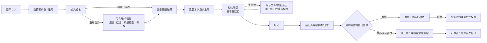
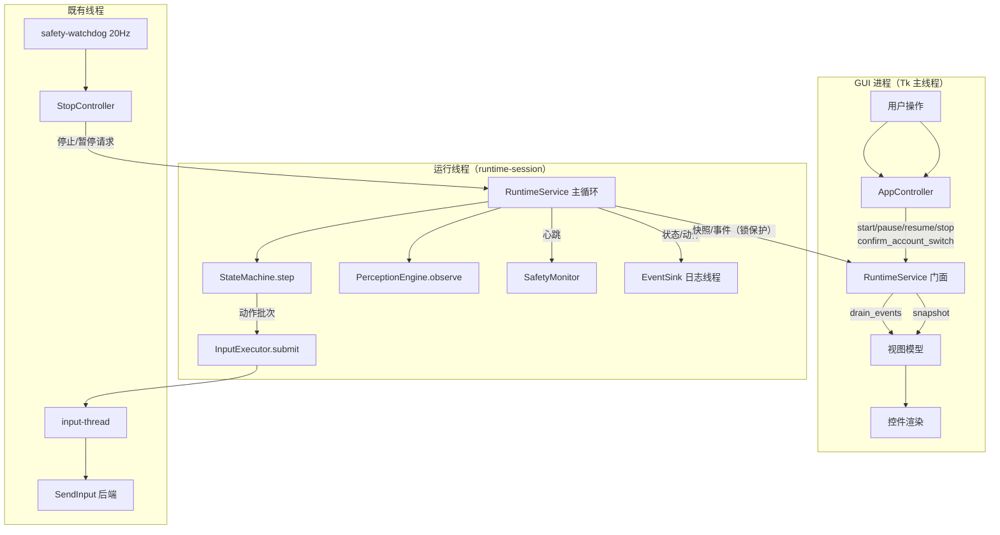
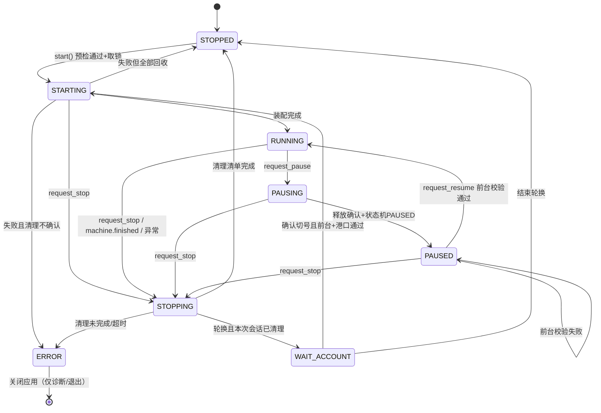
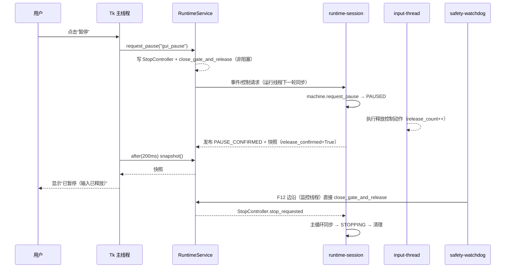
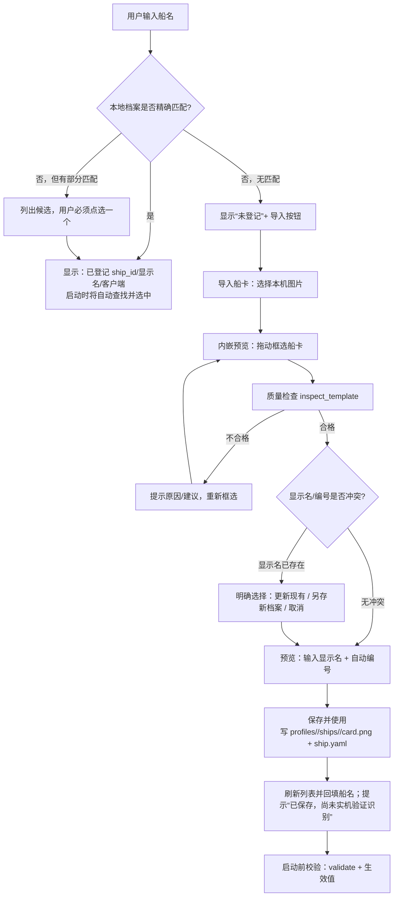

# GUI 界面设计文档（设计稿，未实施）

界面布局、性能与数据面板、运行中目标点修改及前台焦点规则，以 [GUI 交互与预览设计](GUI交互与预览设计.md) 为准。本文其余运行服务与安全契约继续作为技术依据。两份文档均为设计稿，不代表 GUI 已实现。

> **状态：设计稿，未实施、未编码、未验证。** 本文只描述 GUI 与运行服务的目标设计、接口契约、
> 页面布局、交互流程、实施切片与验收标准；不表示 `src/gui/`、`src/runtime/` 已存在，
> 也不表示任何界面或运行控制能力已经通过验证。README、`docs/项目综述.md` 等文档在实现与
> 实机验证前不得标记 GUI 为“已实现/已验证”。
>
> 本文档不修改任何代码、配置或其他文档；实现由后续任务按第 13 节的切片执行。

| 项目 | 内容 |
| --- | --- |
| 文档名称 | GUI 界面设计文档 |
| 版本 | v0.1（设计稿） |
| 编写日期 | 2026-10-31 |
| 代码基线 | 以提交 `b69f0fc` 为基线编写；**编写期间**并行修复已落地部分 10.3～10.10 的代码改动（如 `src/common/single_instance.py`、`InputExecutor.close_gate_and_release()`、`SafetyWatchdog(on_event=…)`、`_EventBridge.set_battle_id()`，见 0.1.1）；本文对这些接口的引用以实际落地签名为准，但**未逐项验证其行为**；`src/runtime/`、`src/gui/` 仍未实施 |
| 设计依据（优先级从高到低） | ① `docs/实机问题记录.md` 的 ISS-001～ISS-010 与“GUI 升级简要设计（建议稿）”；② `design/详细设计评审与实现补充.md` **第 10 节（2026-10-31 修复口径）**；③ 详细设计 Word v0.4；④ 代码现状（只读核对） |
| 冲突处理 | 与补充文档第 10 节冲突时**以第 10 节为准**；与详细设计 Word 冲突时以补充文档为准；实机证据优先于以上全部 |
| 适用读者 | 实现者、评审者、Lead；本文的“需裁决问题”见附录 C，**Q1～Q7 已于 2026-10-31 由 Lead 裁决（见附录 D），实施以附录 D 为准** |

## 0. 文档定位与证据口径

### 0.1 三种证据等级

本文所有陈述按来源分三级，并在正文标注，防止把设计意图当成既有能力：

| 等级 | 含义 | 例子 |
| --- | --- | --- |
| **【现状】** | 编写时已在代码/配置中存在的真实能力，可直接引用类名、字段、文件路径 | `src/main.py` 的 `_build_runtime()`、`InputExecutor.release_all()`、`accounts.yaml` 的 `alias` 字段 |
| **【第 10 节】** | 补充文档第 10 节已裁决的修复口径与接口；编写期间部分已落地（见 0.1.1），未落地/未验证的部分仍按“设计口径”对待 | 已落地：`InputExecutor.close_gate_and_release()/open_gate()/reset_after_failure()`、`src/common/single_instance.py`、`SafetyWatchdog(on_event=…)`；未落地示例：10.1 的 `full_map_*` 等待/验证参数 |
| **【本文设计】** | 本文新提出的设计决策，需要实施与评审 | `RuntimeService`、`RunLifecycle`、`RunSnapshot`、三个页签的控件与按钮矩阵 |

### 0.1.1 编写期间并行落地说明（重要）

本文编写期间 P0/P1 修复任务并行推进，工作区中已出现第 10 节的部分实现（编写开始时基线尚未包含）：

| 已出现的改动（未逐项验证） | 位置 |
| --- | --- |
| `SingleInstanceLock`（`acquire()/holder/release()`）+ `EXIT_INSTANCE_RUNNING = 3` | `src/common/single_instance.py`、`src/main.py` |
| `close_gate_and_release(reason="", *, wait=False, timeout=2.0) -> int`、`open_gate(reason="") -> bool`、`reset_after_failure() -> bool` | `src/execution/queue.py` |
| `SafetyWatchdog(safety, on_event=…)`；安全事件回调直接调用 `executor.close_gate_and_release(...)` | `src/execution/safety.py`、`src/main.py` |
| `_enter_paused` 改为门禁释放 + `_open_input_gate()`、`_abort_battle()` | `src/state_machine/machine.py` |
| `ShipProfile.selected_feature`（ISS-007 口径） | `src/config/models.py`、`profiles/cn360/ships/*/ship.yaml` |
| `DeathSignals` 的 10.2 字段与 `battle_hud` 新配置（`hp_bar_empty_max_ratio` 等） | `src/common/types.py`、`src/config/models.py` |
| `_EventBridge.set_battle_id()` 与 `MachineDeps.on_battle_context` 回调 | `src/main.py`、`src/state_machine/machine.py` |

处理原则：

1. 这些是**并行实现的工作区事实**，本文只按接口名/签名引用，不宣称其行为已验证；
2. 本文与第 10 节冲突时以第 10 节为准；实际落地签名与本文描述有差异时，以落地代码为准并在实施任务中记录；
3. `CapabilityFlags` 仍按 15.2 的纪律：**只有对应测试通过后**才置 True，不因“代码已出现”而提前承诺；
4. `src/runtime/`、`src/gui/` 在本文完成时仍不存在，M0 起才开始实施。

### 0.2 硬性约束（贯穿全文）

1. GUI **不直接调用 `SendInput`**，不导入 `src.execution.winput`，不直接持有 `InputExecutor`；
   所有键鼠输出仍由现有输入线程（`src/execution/queue.py` 的 `InputExecutor`）唯一出口执行。
2. GUI **不另写一套状态转移**；游戏流程仍由 `src/state_machine/machine.py` 的 `StateMachine` 决定，
   GUI 只显示“脚本生命周期”和“游戏流程状态”，不根据界面自行推进流程。
3. GUI **不增加密码、令牌、验证码、Cookie 等任何凭据输入框**；账号只展示 `accounts.yaml` 的本地别名。
4. GUI **不把识别分数显示成游戏数值**（尤其不得出现“识别分数 = 血量”），血量只以
   【第 10 节】10.2 的“证据状态”（存活 / 归零 / 无法判断 / 不可用）展示，且不授权 GUI 自行退出战斗。
5. GUI **不承诺未修复的能力**：建立能力开关表（第 15.2 节），任何依赖 ISS 修复的功能在修复落地前
   在界面上明确写“未接入/不承诺”，不得只靠文案暗示。
6. 所有运行日志、截图、数据库只写本地；GUI 不联网、不上传、不读取游戏内存与网络数据。

### 0.3 术语

| 术语 | 含义 |
| --- | --- |
| 生命周期（lifecycle） | 运行服务自身状态：`STOPPED / STARTING / RUNNING / PAUSING / PAUSED / STOPPING / WAIT_ACCOUNT / ERROR` |
| 游戏流程状态 | 状态机状态：`INIT / PORT / START_COOP / QUEUEING / LOADING / BATTLE_ACTIVE / … / STOPPING`（`src/common/types.py` 的 `State`） |
| 运行服务 | 【本文设计】`src/runtime/service.py` 的 `RuntimeService`，命令行与 GUI 共用的唯一运行入口 |
| 快照 | 【本文设计】`RunSnapshot`，运行服务线程发布的不可变只读状态，GUI 只能读 |
| 事件 | 【本文设计】`RuntimeEvent`，运行服务向 GUI 推送的结构化通知 |
| 输入门禁 | 【第 10 节】10.4：暂停/停止时先关闭业务输入门禁、使旧批次失效、清空队列并释放键鼠 |
| 停止确认 | 输入线程真正执行完“释放所有键鼠”并记录释放计数；停止按钮的承诺以此为准 |

## 1. 目标与范围

### 1.1 背景与继承关系

`docs/实机问题记录.md` 末尾的“GUI 升级简要设计（建议稿，未实施）”已确定方向：
把命令行脚本升级为 Windows 本地控制台，复用现有识别/状态机/输入/存储模块，不推倒重来。
本文在该建议稿基础上扩展出可实现的接口契约、页面线框、状态语义、切片与验收，**不改变其原则**：

- 技术方案仍为 Tkinter + ttk（理由见第 2 节）；
- 架构仍为“从 `src/main.py` 提取共享运行服务，命令行与 GUI 共用”（第 3 节）；
- 页面仍为“运行页 / 日志页 / 标定与设置页”三页签（第 7 节）；
- 选船仍为“输入船名 + 首次导入船卡截图”，不做 OCR（第 8 节）；
- 停止/暂停/关闭窗口语义仍以“输入真正释放”为确认（第 6、11 节）。

### 1.2 目标

| 目标 | 具体含义 |
| --- | --- |
| G1 操作更直观 | 用户不需要记命令行参数：选客户端、输入船名、选账号、设场次上限，点“启动”即可；首次缺船卡时在同一窗口完成导入 |
| G2 运行状态可判断 | 随时能回答：脚本在做什么（生命周期 + 游戏流程状态）、为什么暂停（原因原文）、是否真的在控制（输入门禁/释放计数）、最近一帧是否新鲜、场次进度 |
| G3 停止与清理可验证 | “停止”与“关闭窗口”都有明确的“停止中→已停止”过渡和清理清单；清理未完成时不允许再次启动，且显示日志位置 |
| G4 复用而不重写 | 游戏流程、输入、感知、存储逻辑全部复用现有模块；GUI 只做展示与转发；命令行行为保持兼容 |
| G5 安全边界不退化 | 不新增凭据输入、不直连 `SendInput`、不绕过状态机、不在运行中写配置 |

### 1.3 第一版范围（M0～M3 交付）

| 功能 | 第一版是否包含 | 说明/依赖 |
| --- | --- | --- |
| 客户端选择（`profiles/<client_id>/`） | 包含 | 只读扫描 `profile.yaml` 的 `client_id/display_name` |
| 船名输入 + 已有档案匹配/候选 | 包含 | 复用 `src/main.py` 的 `_list_ships()`/`_resolve_ship()` 等价逻辑，移入运行服务 |
| 首次船卡导入（选图、框选、质量检查、保存） | 包含（M2） | 复用 `src/tools/calibrate_common.py`；写 `profiles/<client>/ships/<id>/` |
| 本地账号别名选择（不轮换） | 包含 | 只读 `accounts.yaml`，无凭据 |
| 会话间账号轮换与“等待手动切号” | 包含（M3） | 对应 CLI `--rotate`；阻塞 `input()` 改为 `WAIT_ACCOUNT` 状态 |
| 场次/时长/每日上限展示 | 包含 | 数据来自 `safety/session/accounts` 配置与数据库统计 |
| 启动前配置校验与生效值展示 | 包含 | 服务预检 + `src.tools.validate` 完整校验（子进程） |
| 启动/暂停/恢复/停止 | 包含 | 依赖【第 10 节】10.3～10.10 的输入门禁与安全监控 |
| 生命周期/游戏状态/暂停原因/场次/最近帧/导航反馈展示 | 包含 | 快照字段见 4.5 |
| 日志页（有界、筛选、本场事件、打开目录） | 包含 | 事件流 + `logging` 桥接；完整记录仍在 `logs/` |
| 标定工具入口（船只/界面区域/自身标记/环境检查/校验/统计） | 包含（M2） | 子进程调用现有 `src.tools.*`，与自动化互斥 |
| 全屏地图标定（ISS-001 前置）入口 | 第一版仅说明与限制 | 【第 10 节】10.1 的标定属于 ISS-001 修复工作本身，GUI 不新建标定算法 |
| 高级参数（阈值、权重、随机区间等） | 不包含 | 第一版仍由 YAML 管理，GUI 只读展示关键生效值 |

### 1.4 明确非目标

1. 不做多窗口/多账号并发：同一时间仍只运行一个账号、一个游戏窗口（沿用安全边界）。
2. 不自动登录、不代登录、不处理验证码、不保存凭据。
3. 不做远程控制、不上传日志、不联网服务。
4. 不做 OCR、不自动识别船名、不从任意整张截图自动分割船卡（导入需用户框选一次）。
5. 不读取游戏内存、不修改客户端文件、不抓取网络数据。
6. 不做 exe 打包与安装器（【本文设计】M3 之后单独评估；见 16.2）。
7. 不做地图包/waypoints 模式的新标定界面（GUI 可提供入口，但默认 autopilot 不需要地图包）。
8. 不实现“界面内编辑所有配置文件”（高级参数仍改 YAML；GUI 在运行中禁止任何写入）。
9. 不把 GUI 作为绕过现有安全约束的入口：F12/F11、单实例、前台要求、场次上限一律沿用。

### 1.5 成功标准（可验证判据）

| 编号 | 成功标准 | 可验证方式（离线优先） |
| --- | --- | --- |
| S1 | 用户只输入船名 + 点启动即可开始一次会话（已有船卡档案时） | GUI 冒烟 + 手动流程；服务层测试校验 `StartOptions(ship_name=...)` 解析到正确 `ship_id` |
| S2 | 任意时刻界面都能给出“生命周期 + 游戏流程状态 + 暂停原因”三要素 | 服务层测试：构造各状态快照，GUI 视图模型映射到中文文案 |
| S3 | 点击停止后，界面必须显示“停止中”，只有清理清单完成才显示“已停止”，未完成时显示 `ERROR` 且禁止启动 | `FakeRunner` 测试：cleanup 成功/失败两条路径；GUI 视图模型断言按钮矩阵 |
| S4 | 暂停/停止请求后，GUI 能显示“输入门禁已关闭 + 释放计数/确认状态”；未接入门禁时明确显示“不承诺” | `CapabilityFlags.input_gate/release_confirmed` 驱动文案；服务层测试 |
| S5 | 关闭窗口时先异步停止，窗口保持响应，清理完成才销毁；不给用户“关掉窗口=结束进程”的错觉 | GUI 冒烟测试（fake service）+ 手动冒烟清单 |
| S6 | 重复点击启动、命令行与 GUI 同时启动，最多只有一个控制实例 | 服务层测试（单实例依赖【第 10 节】10.3）+ 手动测试 |
| S7 | 运行中窗口不卡死（主线程无阻塞调用），日志长跑不无界增长 | 代码评审规则 + GUI 冒烟（fake slow runner）+ 有界缓冲测试 |
| S8 | 所有展示数值都有明确来源与口径，不出现“识别分数=血量”等误导 | 文案审查清单（附录 B）+ 视图模型测试 |
| S9 | 异常路径显示具体文件/字段/原因，且只有清理完成后才允许重启 | 服务层测试 + 视图模型测试 |
| S10 | 未修复的 ISS 能力在界面上有明确“未接入/不承诺”标记 | `CapabilityFlags` 默认全 False 的测试 + 界面审查 |

### 1.6 用户操作主线（一次托管）



## 2. 技术选型

### 2.1 结论

【本文设计】**第一版采用 Python 标准库 `tkinter` + `ttk`**，主窗口用 `ttk.Notebook` 组织三个页签，
图像框选复用已有的 `src/tools/calibrate_common.py` 的 `ImageCanvas`。不新增第三方依赖。

### 2.2 选择 Tkinter + ttk 的理由

| 理由 | 说明 |
| --- | --- |
| 无新增依赖 | 【现状】项目依赖为 numpy / opencv-python / PyYAML（`requirements.txt`）；GUI 用标准库不改变依赖与打包体积 |
| 已有可复用实现 | 【现状】`src/tools/calibrate_ship.py` 的 `ShipCalibrationApp`、`calibrate_profile`、`capture_marker` 已用 Tkinter 窗口 + `calibrate_common.ImageCanvas`，船卡框选、缩放、临时 PNG 显示、质量检查都有现成纯函数；GUI 的导入页可直接复用 |
| 范围匹配 | 单机控制台只需表单、按钮、状态标签、页签和只读日志列表，ttk 足够；不需要复杂图表/大型表格/富交互 |
| 本地进程内集成 | Tk 与运行服务同进程，便于“停止确认、事件流、快照轮询”直接通信；不需要本地 HTTP 服务与前后端进程管理 |
| 维护成本低 | 单人/小团队项目，减少 Qt 许可、版本升级、打包工具链的长期维护面 |
| 风格可接受 | Windows 上 `ttk` 的 `vista` 主题 + 中文字体即可满足“本地工具”观感；不追求定制视觉 |

### 2.3 本机检查项（必须先做的只读检查）

【本文设计】Tkinter 在 Python 3.14 的可用性列为**本机检查项**，M1 开工第一步执行；检查结果记入
实现任务报告，不写入本文（本文不声称已验证）。

```powershell
# 1) 解释器版本
py -3.14 -c "import sys; print(sys.version)"

# 2) Tk 是否随解释器安装（只导入，不创建窗口）
py -3.14 -c "import tkinter; print('Tk', tkinter.TkVersion, 'Tcl', tkinter.TclVersion)"

# 3) 能否真正创建窗口（会短暂闪一个空窗口；请在游戏未运行时执行）
py -3.14 -c "import tkinter; r=tkinter.Tk(); r.update(); print('screen', r.winfo_screenwidth(), r.winfo_screenheight(), 'dpi', r.winfo_fpixels('1i')); r.destroy()"

# 4) ttk 主题可用性（同上，会短暂闪窗口）
py -3.14 -c "import tkinter; from tkinter import ttk; r=tkinter.Tk(); s=ttk.Style(); print(s.theme_names(), s.theme_use()); r.destroy()"
```

- 检查 1、2 为纯只读；检查 3、4 会创建窗口句柄，不能在自动化运行期间执行。
- 若检查 3/4 失败（缺 Tk 组件/无桌面会话），GUI 第一版降级为“仅命令行”，GUI 入口给出
  中文错误并以非 0 退出码结束；不得因此改动运行服务的行为（见 2.6）。
- 编写本文时的本机只读核对：`py -3.14 -c "import tkinter; …"` 返回
  `Python 3.14.5 / TkVersion 8.6 / TclVersion 8.6`。**这只是解释器带 Tk 的导入证据，
  不是窗口、DPI、中文输入、ttk 主题或打包兼容性的验证。**

### 2.4 为何不选 PySide6 / 本地网页

| 方案 | 优点 | 不选的理由（第一版） |
| --- | --- | --- |
| PySide6（Qt） | 多页签/复杂表格/图像标定更强，控件更现代 | 新增 Qt 运行时依赖与约百 MB 级打包体积；需重新验证 Python 3.14 与工具链、许可证合规、exe 打包；与项目“轻量依赖、本地小工具”的方向不符。等确实需要在同一窗口反复编辑区域/模板时再评估 |
| 本地网页 + Python 后端 | 布局灵活、可跨设备查看 | 引入本地 HTTP 服务、端口管理、前后端协议、进程生命周期、浏览器安全边界；单机控制台场景偏重；且“本地服务”容易被误解为远程控制，与安全边界冲突 |
| Electron / WebView2 | 界面表现力强 | 依赖更重，且同样需要本地服务与打包链；第一版不评估 |
| 命令行 + 控制台菜单 | 零依赖 | 无法满足“状态可判断、停止与清理可验证、船卡框选”的目标；现有 CLI 保留但作为高级入口 |

### 2.5 界面技术约束（本设计固定）

1. **单窗口 + `ttk.Notebook` 三页签**；不默认置顶（`safety.topmost` 只描述游戏窗口，不是 GUI 窗口），
   不自动抢游戏焦点，不弹会抢焦点的日志窗口。
2. 字体：`Microsoft YaHei UI` 10pt（Windows 11 默认中文界面字体），由 `ttk.Style` 统一设置；
   字号/尺寸经 100% 与 125% 缩放检查（16.2 未验证项）。
3. **DPI**：在创建 Tk 根窗口之前调用【现状】`src/common/window.py` 的 `set_dpi_awareness()`
   （其文档要求“必须在创建窗口句柄/截屏之前调用”），保证 GUI 与截屏/点击坐标使用同一 DPI 口径；
   运行时装配再次调用该函数时按现状返回实际模式字符串（重复调用的具体返回值列为 M1 检查项）。
4. GUI 进程内允许使用 `numpy/opencv`（已有依赖）：船卡预览与质量检查复用
   `calibrate_common.read_image()/inspect_template()/crop_region()`；不引入 Pillow。
5. GUI 不创建网络监听端口，不写 `config.yaml/accounts.yaml/profiles/*` 之外的任何文件；
   `profiles/` 下的写入只由“船卡导入”或标定工具子进程完成，且仅在自动化停止后。
6. **日志控制台口径（已裁决 Q7）**：第一版保持 `configure_text_logging(console=True)` 默认行为
   （便于从终端启动时观察）；`pythonw`/无控制台启动时 stdout 可能不可用，需捕获 stdout 写入异常，
   属**打包前待解决项**（第一版不打包 exe，暂不处理；见 16.2 U8）。

### 2.6 可用性降级

- Tk 不可用（见 2.3）时：`python -m src.gui` 打印中文原因（含“Tk 包缺失/无桌面会话”区分）并返回
  非 0 退出码；命令行 `python -m src.main` 行为完全不变。
- 运行服务本身不依赖 Tk：**`src/runtime/*` 不得 `import tkinter`**（由测试守护，见 14.2），
  因此 GUI 不可用不影响任何自动化能力。

## 3. 总体架构

### 3.1 现状（只读核对）

【现状】`src/main.py` 同时承担了：CLI 参数解析、配置/账号加载、船只名称解析、运行时装配、
单账号会话主循环、账号轮换与手动切号提示。关键符号：

| 符号 | 现状职责 |
| --- | --- |
| `Runtime`（dataclass） | 一次会话的全部对象集合：`app/clock/window_locator/capture/engine/events/screenshots/executor/steps/navigator/behavior/session/ship_checker/machine/safety/watchdog/bridge/logger` |
| `_EventBridge` | 导航/行为/步骤回调桥接到 `EventSink`，维护 `battle_id`（当前值从未更新，即 ISS-010） |
| `_build_runtime(app)` | 装配日志（`configure_text_logging`）、DPI、`WindowLocator`、`GdiCapture`、`PerceptionEngine`、`EventSink`、`ScreenshotManager`、`InputExecutor`、`Navigator`/`AutoPilotNavigator`、`BehaviorScheduler`、`StepSequenceExecutor`、`SessionController`、`ShipChecker`、`SafetyMonitor`/`SafetyWatchdog`、`StateMachine` |
| `_teardown(runtime)` | 依次 `watchdog.stop()`、`executor.stop(drain=True)`、`screenshots.cleanup_session()`、`events.stop(drain=True)`、`engine.close()` |
| `_run_session(runtime, max_battles)` | 主循环：心跳、同步 `StopController` 停止/暂停、每秒窗口/前台检查、`engine.observe()`、`machine.step()`、`executor.submit()`、按 `runtime.loop_hz`（默认 10 Hz）节拍休眠；`KeyboardInterrupt` 转 `request_stop("manual")`；返回 `(停止原因, 场次)` |
| `_sync_safety_controller(machine, controller)` | 把 `StopController` 的停止/暂停请求同步给状态机（主循环内） |
| `_ensure_game_foreground(runtime)` | 启动阶段把游戏窗口切前台并校验（`WindowLocator.bring_to_foreground()` + 0.3s 后复查） |
| `_resolve_ship/_list_ships` | `--ship-name` 在已有 `ships/*/ship.yaml` 的 `display_name/ship_id` 中精确/部分匹配，重名报错 |
| `main()` | 参数解析、配置校验、逐账号 `_build_runtime → _run_session → _teardown`、轮换时 `input()` 阻塞等待手动切号 |

> 编写期间 `src/main.py` 已增加：`SingleInstanceLock` 获取（冲突返回 `EXIT_INSTANCE_RUNNING = 3`）、
> `_on_safety_event()` 安全事件回调（监控线程内关输入门禁）、`_EventBridge.set_battle_id()` 与
> `MachineDeps.on_battle_context` 场次上下文回调、`_build_runtime` 的部分失败回收等（见 0.1.1）。
> M0 迁移时这些新增逻辑随 `_build_runtime/_run_session/_teardown` 一起进入 `src/runtime/`，
> 不得在 GUI 侧重复实现。

**问题**：这段代码与 `argparse`/`print`/`input()` 绑定，无法直接被 GUI 按钮复用；异常路径的清理
依赖调用顺序（ISS-008），暂停/停止与输入释放的确认也不可观测（ISS-004/005/009 的 GUI 影响来源）。

### 3.2 目标结构（拟议，未实施）

```text
src/
  main.py                     命令行入口：参数解析与提示，调用 RuntimeService（保持现有参数/退出码）
  runtime/
    __init__.py
    messages.py               控制命令、生命周期、运行快照、事件的数据类型（纯数据，无 Tk、无 ctypes）
    service.py                RuntimeService：会话生命周期、命令/事件队列、单实例、统一清理
    runner.py                 默认 SessionRunner：把现有 _build_runtime/_run_session/_teardown 迁入
    plan.py                   启动选项解析与生效值（船只名称解析、账号覆盖、上限计算、预校验）
    capabilities.py           能力开关（对应未修复的 ISS 能力），只由已落地的修复显式打开
  gui/
    __init__.py
    main.py                   GUI 启动入口（Tk 根窗口、DPI、单开提示、report_callback_exception）
    app.py                    AppController：快照/事件 → 视图模型；按钮 intent 分发（不直接操作控件）
    viewmodel.py              纯函数/数据类：生命周期中文文案、按钮可用性矩阵、状态区格式化
    run_page.py               运行页（配置、控制、状态、最近事件）
    log_page.py               日志页（有界日志、筛选、本场事件、目录入口）
    tools_page.py             标定与设置页（工具子进程、校验、能力/风险展示）
    ship_import.py            船名输入辅助、船卡导入（框选/质量检查/保存）纯逻辑与对话框
    widgets.py                可复用控件（状态徽章、只读表格、日志行 tag 等）
  common/single_instance.py   【第 10 节】10.3 的命名互斥量 + data/wows_script.lock（新增）
```

> 命名与目录仅为设计建议；实施时若个别文件名调整，必须保持 3.3 的职责边界与 4、5 节的契约不变。

### 3.3 分层与职责边界

| 层 | 负责 | 不负责（禁止） |
| --- | --- | --- |
| `src/gui/*` | 控件、布局、中文文案、用户意图 → `RuntimeService` 调用、快照/事件 → 视图模型、标定工具子进程管理 | 直接调用 `SendInput`/`InputExecutor`；直接读写 `StateMachine` 内部状态并推进流程；直接写 `config.yaml/profiles`（除导入流程经服务互斥检查后写船卡）；阻塞主线程；在非主线程操作 Tk |
| `src/runtime/*` | 启动选项解析与预检、单实例、运行时装配（调用现有模块）、会话主循环、生命周期、命令/事件/快照、统一清理 | 创建 Tk 控件；改变游戏流程决策（仍由 `StateMachine`）；绕过 `SafetyMonitor`/`StopController`；把凭据写入日志 |
| `src/state_machine/*` | 游戏流程与暂停/停止状态、选船/装备/退出流程 | 启动/停止线程；处理 GUI 事件 |
| `src/execution/*` | 输入线程、队列、门禁、安全热键/看门狗 | 决定游戏流程；直接操作数据库 |
| `src/perception/*` | 截屏与识别，产生 `Observation` | 发送输入；决定流程 |
| `src/storage/*` | SQLite、文本日志、截图管理 | 决定流程；与 GUI 直接交互 |
| `src/tools/*` | 标定/校验/统计/录制回放（各自 CLI/Tk 窗口） | 与自动化并发操作游戏 |

### 3.4 数据流



### 3.5 与命令行入口的关系

【本文设计】`src/main.py` 改为薄壳：

1. `build_parser()` 保留现有全部参数（`--root/--profile/--ship/--ship-name/--list-ships/--account/--rotate/--max-battles/--dry-run/--log-level/--version`），行为与退出码不变；
2. `--list-ships`、`--dry-run` 仍可直接调用 `plan.py` 的只读解析；
3. 正常运行改为：`service = RuntimeService(root)` → `service.start(StartOptions(...))` → 控制台循环读取
   `snapshot()` 打印关键状态（或保持现有简洁输出）→ 账号轮换时 `input()` 等待后调用
   `service.confirm_account_switch()`；
4. CLI 与 GUI 共用同一 `RuntimeService` 与同一把单实例锁（【第 10 节】10.3），天然互斥；
5. `src/main.py` 不再直接 `new` 感知/状态机/输入对象，只经 `RuntimeService`。

## 4. `src/runtime/messages.py` 契约（【本文设计】）

### 4.1 模块原则

- 纯数据：只依赖 `dataclasses/enum/pathlib/typing` 与项目内 `src/config/models.py` 的只读类型；
  **不得导入 tkinter、ctypes、cv2、线程实现**；不得有 IO。
- 全部对外数据类型为 `@dataclass(frozen=True, slots=True)`；`Mapping/dict` 字段在构造时做浅拷贝，
  文档约定“调用方不得修改快照内部对象”，实现层用 `dict()` 复制。
- GUI 只读快照与事件；任何“命令”都通过 `RuntimeService` 方法表达，不直接改快照字段。

### 4.2 生命周期枚举 `RunLifecycle`

```python
class RunLifecycle(StrEnum):
    STOPPED = "STOPPED"            # 未运行；清理已完成；可启动
    STARTING = "STARTING"          # 已接受启动：取锁、加载配置、装配运行时、切前台中
    RUNNING = "RUNNING"            # 运行线程在主循环；输入门禁打开
    PAUSING = "PAUSING"            # 已请求暂停：门禁关闭、等待释放确认/状态机进入 PAUSED
    PAUSED = "PAUSED"              # 已暂停：输入已释放，运行线程仍存活但不再控制
    STOPPING = "STOPPING"          # 已请求停止：等待运行线程退出 + 统一清理完成
    WAIT_ACCOUNT = "WAIT_ACCOUNT"  # 会话间轮换：当前账号已清理完毕，等待用户手动切号确认
    ERROR = "ERROR"                # 清理/生命周期无法确认安全：禁止启动，只允许诊断与退出
```

**与游戏流程状态的分工**（本文强制区分，界面不得混用）：

- 生命周期回答“脚本本身是否在控制、是否安全可重启”；
- 游戏流程状态回答“游戏画面处于哪个阶段”（`StateMachine.state`，`src/common/types.py` 的 `State`）；
- 允许的组合示例：`RUNNING + BATTLE_ACTIVE`、`PAUSED + PAUSED`、`STOPPED + BATTLE_ACTIVE`（脚本已停、
  游戏仍在战斗，界面必须提示“脚本已停止控制，游戏仍在战斗中，未替你退出”）；
- 禁止的展示：把 `STOPPING` 显示成“运行中”，把 `WAIT_ACCOUNT` 显示成“已暂停”，
  未运行时显示“运行中”（对应验收项 17.1）。

### 4.3 `StartOptions`

```python
@dataclass(frozen=True, slots=True)
class StartOptions:
    root: Path
    profile_id: str | None = None            # None → config/默认 cn360
    ship_name: str | None = None             # 界面主输入（显示名/简称）
    ship_id: str | None = None               # 高级/兼容 CLI --ship；与 ship_name 同时给出时以 ship_id 为准
    account_alias: str | None = None         # None → 不使用账号档案（与 CLI 默认一致）
    rotate: bool = False                     # 对应 CLI --rotate
    max_battles: int | None = None           # 对应 CLI/GUI 的本次场次上限；None → 用账号/轮换/配置上限
    log_level: str | None = None             # 覆盖 runtime.log_level（本次会话）
    start_paused: bool = False               # GUI 可选“先暂停启动”（见 11.1）
```

校验规则（`plan.py` 实现，`RuntimeService.start()` 入口先做快速校验）：

| 字段 | 规则 |
| --- | --- |
| `root` | 必须是包含 `config.yaml` 的目录，否则 `START` 被拒（问题码 `root_invalid`） |
| `profile_id` | 必须在 `profiles/<id>/profile.yaml` 存在（`profile_not_found`） |
| `ship_name`/`ship_id` | 至少一个或回退 `config.yaml ship.ship_id`；名称解析失败/多义时拒绝并列出候选（`ship_unresolved`/`ship_ambiguous`） |
| `account_alias` | 非空时必须存在于 `accounts.yaml`，否则拒绝（`account_not_found`）；`rotate=True` 时要求 `accounts.yaml` 的 `rotation.enabled=true` 且存在启用账号（`rotation_disabled`/`rotation_empty`） |
| `max_battles` | `None` 或 `>0` 的整数；`<=0` 拒绝（`max_battles_invalid`） |
| `log_level` | `DEBUG/INFO/WARNING/ERROR` 之一，否则拒绝（`log_level_invalid`） |
| `start_paused` | 仅 GUI 使用；CLI 忽略（`False`） |

### 4.4 预检结果与生效值

```python
@dataclass(frozen=True, slots=True)
class ValidationIssueView:      # 来自 src/config/validate.py 的 ValidationIssue 只读映射
    severity: str               # "error" | "warning"
    code: str
    location: str               # 文件/字段路径，例如 "config.yaml:safety>max_battles_per_session"
    message: str

@dataclass(frozen=True, slots=True)
class EffectivePlan:            # “本次实际会用到什么”（账号覆盖后的真实值）
    client_id: str
    client_display_name: str
    ship_id: str
    ship_display_name: str
    account_alias: str | None
    account_display_name: str | None
    max_battles_override: int | None       # 本次显式上限（GUI/CLI）
    rotation_limit: int | None             # 轮换时该账号的场次上限（AccountRotator.current_limit）
    safety_battle_cap: int                 # safety.max_battles_per_session
    daily_cap: int                         # session.daily_battle_cap（账号覆盖后）
    daily_used: int | None                 # 数据库按别名统计的今日场次（读不到时 None）
    allowed_hours: tuple[str, str] | None  # 账号覆盖后
    max_session_minutes: float             # safety.max_session_minutes
    navigation_mode: str                   # "autopilot" | "waypoints"
    emergency_stop_key: str                # safety.emergency_stop_key（默认 f12）
    resume_key: str                        # safety.resume_key（默认 f11）
    heartbeat_s: float                     # safety.heartbeat_s
    config_hash: str
    log_path: Path                         # 本次将生成的 logs/session_*.log（实际路径 STARTING 后确定）
    db_path: Path                          # data/wows_script.db
    diagnostics_dir: Path                  # logging.diagnostics_dir
    profiles_dir: Path
    start_paused: bool

@dataclass(frozen=True, slots=True)
class PlanResult:
    ok: bool
    plan: EffectivePlan | None
    issues: tuple[ValidationIssueView, ...]       # errors
    warnings: tuple[ValidationIssueView, ...]

@dataclass(frozen=True, slots=True)
class StartResult:
    accepted: bool
    reason: str | None                  # 拒绝码，例如 "already_active"/"validation_failed"/"lock_held"
    issues: tuple[ValidationIssueView, ...]
```

**生效值展示规则**（对应任务要求“账号覆盖后实际客户端/船只/上限”）：

1. 界面必须同时展示三类上限，不得合并成一个含糊数字：
   “本次显式上限（GUI 输入）／配置安全上限 `safety.max_battles_per_session`／今日剩余（`session.daily_battle_cap` - 已跑）”；
2. 轮换模式下再加一行“本账号轮换上限”（`AccountRotator.current_limit()`，来源
   `accounts.yaml` 的 `max_battles_per_session` 或 `rotation.max_battles_per_account`）；
3. 账号覆盖后的客户端/船只以 `EffectivePlan` 为准，并在启动时展示“本次实际使用”；
4. `daily_used` 读不到（数据库忙/异常）时显示“今日场次：读取失败（不影响启动，按配置上限执行）”，
   不得显示 0。

### 4.5 `RunSnapshot`

```python
@dataclass(frozen=True, slots=True)
class LifecycleView:
    lifecycle: RunLifecycle
    since_at: float                 # 进入当前生命周期的单调时钟时间
    since_wall: str                 # 进入时间（本地 ISO-8601，东八区）
    detail: str                     # 生命周期说明（例如 "已停止：会话正常结束（manual）"）
    pending_action: str | None      # "pause" | "resume" | "stop" | "account_switch" | None
    resume_pending: bool            # 已请求恢复、正在做前台校验/状态机确认

@dataclass(frozen=True, slots=True)
class GameView:
    state: str                      # State 值（INIT/PORT/…），未知时 "UNKNOWN"
    state_since_wall: str | None
    pause_reason: str | None        # 状态机暂停原因原文（英文键）
    pause_detail: str | None
    session_id: int | None
    battle_id: int | None
    battle_active: bool             # machine.state.is_battle
    last_transition: str | None     # "PORT -> START_COOP (start_sequence_done)"

@dataclass(frozen=True, slots=True)
class PerceptionView:
    last_frame_id: int
    last_frame_at: float | None     # Observation.frame_timestamp（单调时钟）
    last_frame_wall: str | None
    last_frame_age_s: float | None  # 由服务用 clock 计算
    capture_ms_avg: float | None    # PerceptionEngine.stats().capture_ms_avg
    window_found: bool
    window_foreground: bool
    window_client_rect: tuple[int, int, int, int] | None
    capture_error: str | None

@dataclass(frozen=True, slots=True)
class InputView:
    gate_open: bool                 # 业务输入门禁；False=拒绝新业务动作
    gate_closed_reason: str | None
    pending_actions: int            # InputExecutor.pending_actions
    release_count: int              # InputExecutor.release_count（释放控制动作执行次数）
    release_confirmed: bool         # 暂停/停止请求后是否已确认执行完释放
    last_release_wall: str | None
    executed: int
    rejected: int
    dropped: int
    expired: int
    failed: bool                    # InputExecutor.failed
    consecutive_errors: int
    last_error: str | None          # InputExecutor.last_error 的文本

@dataclass(frozen=True, slots=True)
class NavigationView:
    mode: str                       # "autopilot" | "waypoints"
    surface: str | None             # autopilot: "full_map" | "minimap"（【第 10 节】10.1 后有效）
    click_count: int                # 已发出的导航点击次数
    last_click_wall: str | None
    last_click_target_norm: tuple[float, float] | None   # 目标点归一化坐标
    last_click_from_own_marker: bool | None              # 是否由自身标记推算
    move_confirmed: bool            # 航行是否已确认（【第 10 节】10.1 的 autopilot_confirmed / 旧式移动确认）
    move_confirmed_wall: str | None
    verify_failed: bool             # 最近一次验证失败
    blocks_behavior: bool           # autopilot 是否处于“开图→关图”输入隔离期
    ship_speed_mps: float | None    # Observation.ship.speed_mps（小地图位移估计，不是仪表值）
    ship_marker_source: str | None  # "marker" | "predicted" | "lost" | None
    ship_marker_confidence: float | None

@dataclass(frozen=True, slots=True)
class SessionView:
    account_alias: str | None
    battles_completed: int
    battles_target: int | None      # 本次计划上限（综合 EffectivePlan 的最小约束，展示用）
    battle_in_progress: bool
    elapsed_s: float
    last_battle_duration_s: float | None
    daily_used: int | None
    rotation_index: int | None
    rotation_aliases: tuple[str, ...]
    next_alias: str | None

@dataclass(frozen=True, slots=True)
class CleanupView:
    requested: bool
    input_released: bool
    input_thread_joined: bool
    watchdog_stopped: bool
    event_sink_stopped: bool
    screenshots_cleaned: bool
    capture_closed: bool
    single_instance_released: bool
    pending_items: tuple[str, ...]  # 未完成项的人类可读描述
    completed: bool

@dataclass(frozen=True, slots=True)
class ErrorView:
    code: str
    message: str
    source: str                     # "module.function" 或 "config.yaml:字段"
    detail: str
    at_wall: str | None
    recoverable: bool               # False → 只允许诊断与退出（见 11.6）

@dataclass(frozen=True, slots=True)
class CapabilityFlags:              # 未修复的 ISS 能力；默认 False，界面据此改写文案/禁用
    input_gate: bool = False
    release_confirmed: bool = False
    single_instance: bool = False
    cleanup_on_error: bool = False
    pause_keeps_battle: bool = False
    battle_context: bool = False
    exit_authorized_gate: bool = False
    autopilot_full_map: bool = False
    autopilot_move_verified: bool = False
    ship_selected_evidence: bool = False
    input_failure_pause: bool = False

@dataclass(frozen=True, slots=True)
class RunSnapshot:
    seq: int                        # 快照序号，单调递增
    at: float                       # 生成时的单调时钟
    wall_at: str                    # 生成时的本地时间 ISO-8601
    lifecycle: LifecycleView
    game: GameView
    perception: PerceptionView
    input: InputView
    navigation: NavigationView
    session: SessionView
    plan: EffectivePlan | None
    cleanup: CleanupView
    error: ErrorView | None
    capabilities: CapabilityFlags
```

> 快照字段只增不删；新增字段必须给默认值，避免 GUI 与服务版本错配时崩溃。

### 4.6 `RuntimeEvent`

```python
class RuntimeEventKind(StrEnum):
    LIFECYCLE_CHANGED = "lifecycle_changed"
    GAME_STATE_CHANGED = "game_state_changed"
    PAUSE_REQUESTED = "pause_requested"
    PAUSE_CONFIRMED = "pause_confirmed"
    RESUME_REQUESTED = "resume_requested"
    RESUME_CONFIRMED = "resume_confirmed"
    STOP_REQUESTED = "stop_requested"
    INPUT_RELEASED = "input_released"
    CLEANUP_STEP = "cleanup_step"
    SESSION_STARTED = "session_started"
    SESSION_ENDED = "session_ended"
    BATTLE_STARTED = "battle_started"
    BATTLE_ENDED = "battle_ended"
    ACCOUNT_SWITCH_WAITING = "account_switch_waiting"
    ACCOUNT_SWITCH_CONFIRMED = "account_switch_confirmed"
    NAV_FEEDBACK = "nav_feedback"
    SHIP_CHECK_FAILED = "ship_check_failed"
    INPUT_FAILED = "input_failed"
    VALIDATION_FAILED = "validation_failed"
    TOOL_STARTED = "tool_started"
    TOOL_EXITED = "tool_exited"
    LOG_RECORD = "log_record"
    ERROR = "error"

@dataclass(frozen=True, slots=True)
class RuntimeEvent:
    seq: int
    at: float
    wall_at: str
    kind: RuntimeEventKind
    level: str                     # DEBUG/INFO/WARNING/ERROR/CRITICAL（GUI 日志页用它筛选）
    message: str                   # 中文可读文案（服务生成，不含凭据）
    session_id: int | None
    battle_id: int | None
    detail: Mapping[str, object]   # 结构化补充（起点/终点、原因、计数、文件路径等）
```

事件类型与 GUI 消费方式：

| 事件 | 触发点 | GUI 用途 |
| --- | --- | --- |
| `LIFECYCLE_CHANGED` | 生命周期每次变更 | 更新状态徽章、按钮矩阵、状态栏；`WAIT_ACCOUNT` 弹出等待面板 |
| `GAME_STATE_CHANGED` | 服务检测到 `machine.state` 变化 | 游戏流程状态行、本场事件时间线 |
| `PAUSE_REQUESTED/PAUSE_CONFIRMED` | 收到暂停请求 / 状态机已 PAUSED 且释放已确认 | 暂停原因行、输入门禁行 |
| `STOP_REQUESTED/INPUT_RELEASED/CLEANUP_STEP` | 停止流程 | “停止中→已停止”、清理清单勾选 |
| `SESSION_STARTED/SESSION_ENDED` | `StateMachine.start()` / `_enter_stopping` 完成 | 场次计数、会话结束原因 |
| `BATTLE_STARTED/BATTLE_ENDED` | `_begin_battle_record` / `_finish_battle` 或 aborted | 场次进度、本场事件筛选依据 |
| `ACCOUNT_SWITCH_WAITING/CONFIRMED` | 轮换 | 等待手动切号面板、继续/结束按钮 |
| `NAV_FEEDBACK` | 导航事件（`autopilot_click`、`autopilot_confirmed`、`autopilot_verify_failed` 等） | 导航反馈行（区分“点击已发出/航行已确认”） |
| `SHIP_CHECK_FAILED` | 选船/装备校验失败（现有 `loadout_check_failed`/`ship_check_failed` 暂停原因） | 暂停原因 + 具体原因（来自 `failure_reason`） |
| `INPUT_FAILED` | `executor.failed`（【第 10 节】10.9 后由运行线程转 PAUSED） | 错误横幅、暂停原因“输入后端连续失败” |
| `VALIDATION_FAILED` | 启动校验/完整校验失败 | 错误列表（文件/字段/原因） |
| `TOOL_STARTED/TOOL_EXITED` | 标定工具子进程 | 工具页状态、退出码、完成后重校验提示 |
| `LOG_RECORD` | `logging` 桥接记录（INFO 及以上，DEBUG 需开关） | 日志页正文 |
| `ERROR` | 不可恢复错误 | `ERROR` 横幅与禁用启动 |

**事件与日志的边界**：运行服务只产生“状态级”事件与日志镜像；逐帧识别结果不产生事件、不弹窗，
只在快照中体现（`last_frame_*`、`navigation.*`）。完整文本日志仍由【现状】
`configure_text_logging()` 写入 `logs/session_<时间>.log`（`RotatingFileHandler`，
`logging.log_max_bytes/log_backup_count`），GUI 只是尾部展示与目录入口。

### 4.7 命令与结果

```python
class RunCommandKind(StrEnum):
    START = "start"
    PAUSE = "pause"
    RESUME = "resume"
    STOP = "stop"
    CONFIRM_ACCOUNT_SWITCH = "confirm_account_switch"
    ABORT_ROTATION = "abort_rotation"
    SHUTDOWN = "shutdown"          # 关闭窗口：stop + 进入 STOPPED 后不再接受 start

@dataclass(frozen=True, slots=True)
class RunCommand:
    kind: RunCommandKind
    reason: str = ""
    detail: str = ""
```

规则：

1. `START` 只能在 `STOPPED`（或 `ERROR` 被显式恢复后重新加载？——**不允许**，`ERROR` 只能退出应用，
   见 11.6）时被接受；其余状态返回 `StartResult(accepted=False, reason="already_active")`；
2. `PAUSE/RESUME/STOP/SHUTDOWN` 为幂等请求：重复请求返回 `True` 但只第一次生效，保留第一次原因
   （与 `StopController` 语义一致）；
3. `CONFIRM_ACCOUNT_SWITCH` 只在 `WAIT_ACCOUNT` 生效；`ABORT_ROTATION` 在 `WAIT_ACCOUNT` 生效并把轮换
   结束为 `STOPPED`（不留下任何运行资源）；
4. 所有方法**非阻塞**返回（自身不做 `join`、不做 IO 等待）；真正的线程退出/清理由运行线程在
   后台推进，GUI 通过快照观察。

### 4.8 序号与时间的口径

- 单调时钟：`src/common/clock.py` 的 `Clock.now()`（`SystemClock` = `time.monotonic()`）；
  所有 `at` 字段为该口径；界面展示必须用 `wall_at`（东八区 ISO-8601），不得把 `at` 当时间显示。
- `RunSnapshot.seq` 与 `RuntimeEvent.seq` 各自全局单调递增；GUI 用 `seq` 判断“是否有新数据”，
  不用时间戳比较。
- 事件队列为有界队列（默认 2000 条）：满了丢弃最旧事件并计数（`dropped_events`），
  GUI 在日志页显示“已丢弃 N 条（完整记录见日志文件）”，不得静默丢失。

## 5. `src/runtime/service.py` 契约（【本文设计】）

### 5.1 类与职责

```python
class RuntimeService:
    """命令行与 GUI 共用的唯一运行入口；自身不创建任何 GUI 对象。"""

    def __init__(
        self,
        root: Path,
        *,
        clock: Clock | None = None,
        runner_factory: RunnerFactory | None = None,   # 测试注入假运行时
        event_max: int = 2000,
        snapshot_min_interval_s: float = 0.2,
    ) -> None: ...

    # --- 预检与启动 -------------------------------------------------
    def plan_preview(self, options: StartOptions) -> PlanResult: ...      # 只读、可重复调用
    def start(self, options: StartOptions) -> StartResult: ...            # 非阻塞，立即返回

    # --- 控制（线程安全、非阻塞、幂等） ---------------------------------
    def request_pause(self, reason: str = "gui_pause", detail: str = "") -> bool: ...
    def request_resume(self) -> bool: ...
    def request_stop(self, reason: str = "gui_stop", detail: str = "") -> bool: ...
    def confirm_account_switch(self) -> bool: ...
    def abort_rotation(self) -> bool: ...
    def shutdown(self) -> bool: ...                                        # 关闭窗口用；等价 stop + 禁止再 start

    # --- 观察（GUI 主线程安全调用） -------------------------------------
    def snapshot(self) -> RunSnapshot: ...
    def drain_events(self, limit: int = 200) -> tuple[RuntimeEvent, ...]: ...
    @property
    def lifecycle(self) -> RunLifecycle: ...
```

### 5.2 `start()` 的内部步骤（运行线程执行）

```text
STARTING
  1. 快速校验 options（4.3），失败 → STOPPED + StartResult(accepted=False, reason=…)
  2. 获取单实例锁（【第 10 节】10.3，src/common/single_instance.py）
     失败 → STOPPED + reason="lock_held" + 持有者信息（PID/启动时间/目录）写入事件
  3. 加载配置：load_project / load_app / load_accounts → AppConfig（账号覆盖后）
     + validate_app → errors 则 STOPPED + VALIDATION_FAILED 事件（含文件/字段/原因）
  4. 生成 EffectivePlan（4.4）；创建日志（configure_text_logging）、EventSink、InputExecutor 等
     （按【第 10 节】10.8：构造按创建顺序登记，任一失败回收已创建资源）
  5. 切游戏前台（等价现有 _ensure_game_foreground）；失败不阻塞：事件警告，进入 INIT 后按
     窗口守卫暂停（与现有行为一致）
  6. 构造 StateMachine、SafetyMonitor/Watchdog；watchdog 的 on_event 绑定“直接关闭输入门禁并按需释放”
     （【第 10 节】10.5）
  7. StateMachine.start(now)；若 start_paused，则 request_pause("gui_start_paused")
     → 进入 RUNNING 并开始主循环（主循环内部同步 StopController，与现有 _run_session 等价）
RUNNING
  8. 每轮：心跳、同步 StopController、每秒窗口检查、observe、machine.step、executor.submit、
     发布快照（≤ snapshot_min_interval_s 节流）、检查 executor.failed（10.9 → PAUSED input_failed）
  9. machine.finished → STOPPING（进入统一清理）
```

### 5.3 生命周期转移表

| 当前 | 事件/条件 | 目标 | 说明 |
| --- | --- | --- | --- |
| STOPPED | `start()` 通过预检并成功取锁 | STARTING | 运行线程创建 |
| STOPPED | `start()` 预检失败/锁被占 | STOPPED | 返回 StartResult 拒绝原因，界面展示错误 |
| STARTING | 装配/加载成功 | RUNNING | 开始主循环 |
| STARTING | 装配失败且已全部回收 | STOPPED | 可再次启动；错误事件保留 |
| STARTING | 装配失败且回收不确认 | ERROR | 见 5.9 清理判定 |
| STARTING | `request_stop` | STOPPING | 取消启动：清理已创建资源 |
| RUNNING | `request_pause` | PAUSING | 门禁先关闭并释放；等待确认 |
| PAUSING | 输入释放确认 + `machine.state == PAUSED` | PAUSED | 发布 PAUSE_CONFIRMED |
| RUNNING/PAUSING | `request_stop` | STOPPING | 停止优先于暂停 |
| RUNNING/PAUSED | 主循环异常/`machine` 异常退出 | STOPPING | 统一清理后按清理结果去 STOPPED/ERROR |
| RUNNING | `machine.finished`（正常停止、场次上限、F12 等） | STOPPING | 原因来自 `machine.stop_request` |
| PAUSED | `request_resume` 且前台校验通过 + `StopController.resume()` | RUNNING | 状态机重新识别画面（【第 10 节】10.6） |
| PAUSED | `request_resume` 但前台校验失败 | PAUSED | 保留 `resume_pending`，事件说明原因；不反复抢焦点 |
| PAUSED | `request_stop` | STOPPING | — |
| STOPPING | 清理清单全部完成（5.9） | STOPPED | 发布最终快照与 CLEANUP_STEP×n |
| STOPPING | 清理超时/有未完成项 | ERROR | 保留日志位置；禁止启动 |
| STOPPING | 轮换模式下“本次会话结束且还有下一账号” | WAIT_ACCOUNT | 清理必须先完成（输入/日志/截图都收尾） |
| WAIT_ACCOUNT | `confirm_account_switch()` 且前台+港口预检通过 | STARTING | 按下一账号重新走 start 步骤 |
| WAIT_ACCOUNT | `confirm_account_switch()` 预检失败 | WAIT_ACCOUNT | 事件说明（前台不在游戏/未回港口），保留按钮 |
| WAIT_ACCOUNT | `abort_rotation()`/`request_stop`/`shutdown()` | STOPPED | 结束轮换 |
| ERROR | 只允许 `shutdown()` | ERROR（窗口关闭） | 不进入 STOPPED，不提供“重启” |
| STOPPED | `shutdown()` | STOPPED | 窗口关闭 |



### 5.4 控制通道（快速路径）

【第 10 节】10.5 明确 F12/心跳在监控线程内直接 `executor.close_gate_and_release()`，不等待主循环。
GUI 的暂停/停止属于同一类“控制来源”（10.6 要求 GUI、F11、自动失焦共用同一来源与恢复路径），因此：

```text
GUI 点击暂停/停止
  → RuntimeService.request_pause()/request_stop()（GUI 线程，非阻塞）
      a) 写 StopController（暂停/停止请求，线程安全）
      b) 若服务持有 InputExecutor：调用 close_gate_and_release()（线程安全、非阻塞、只入队释放）
         —— 该接口已按【第 10 节】10.4 落地（`close_gate_and_release(reason="", *, wait=False, timeout=2.0)`）；
            但“GUI 展示释放确认”仍需 M0/M1 接线，接线与测试完成前 `input_gate/release_confirmed` 保持 False
      c) 记录请求时间与原因，发布 *_REQUESTED 事件
  → 运行线程在下一轮主循环同步：machine.request_pause/request_stop、转移状态、写清理
  → 输入线程执行释放控制动作，release_count 递增
  → 运行线程确认后发布 PAUSE_CONFIRMED / INPUT_RELEASED，GUI 才显示“输入已释放”
```

> **未修复前不承诺**：【第 10 节】10.11 明确“10.3～10.10 未完成前 GUI 不承诺‘按钮停止=输入已停止’”。
> 因此当 `CapabilityFlags.input_gate/release_confirmed == False` 时：
> - 停止/暂停按钮仍可点（请求仍会传给现有 `StopController` 与 `machine`，行为等同命令行 F12/暂停）；
> - 状态区显示“输入释放：未接入确认（不承诺已停止）”，并在日志页给出原因；
> - 验收清单第 17.6 节把它们列为“修复落地后回填”的勾选项，不得提前打勾。

### 5.5 命令队列与事件队列

| 队列 | 方向 | 有界 | 满时策略 | 观察者 |
| --- | --- | --- | --- | --- |
| 控制请求（`StopController`） | GUI/看门狗 → 运行线程 | 单值（首个原因） | 幂等，保留第一次原因 | 运行线程每轮同步 |
| `RunCommand` 队列 | GUI → 运行线程 | 64 | `START` 会被拒（已有活动会话）；其余为幂等请求，队列满只记录警告 | 运行线程 |
| `RuntimeEvent` 队列 | 运行线程 → GUI | 2000 | 丢最旧并计数，GUI 显示“已丢弃 N 条” | GUI `after()` 轮询 |
| 快照 | 运行线程 → GUI | 单值（最新） | 覆盖旧值 | GUI `after()` 轮询 |

- 所有队列/快照由锁保护；GUI 侧永远只做“非阻塞取出”，不等待运行线程。
- 事件序号连续；GUI 发现 `seq` 跳变（丢弃）时在日志页插入一条“事件丢失”提示。

### 5.6 与状态机的边界

- `RuntimeService` 只调用 `StateMachine` 的公开方法：`start(now)`、`step(observation, now)`、
  `request_pause(reason, detail)`、`request_resume()`、`request_stop(reason, detail)`、
  `set_rotation_limit(limit)`、`update_window_info(info)`，并读取 `state/finished/stop_request/
  battles_completed/battle_id/session_id`。
- **不**直接改 `_state`、不复制转移表、不在 GUI 里根据画面自行切换流程。
- 【第 10 节】10.6 的恢复分流（当前会话战斗内恢复保留 `battle_id`、新进程不接管战斗）由状态机实现，
  服务只负责“恢复请求来源统一 + 前台校验后转发”；界面只显示结果。

### 5.7 与输入线程、看门狗、数据库的边界

| 模块 | 服务如何使用 | 禁止 |
| --- | --- | --- |
| `InputExecutor`（`src/execution/queue.py`） | 创建/启动/`submit`（主循环提交状态机动作）/`stop(drain=True)`/读取统计；暂停/停止时经控制通道关输入门禁 | 服务/GUI 直接调用输入后端；重复创建第二个输入线程 |
| `SafetyMonitor`/`SafetyWatchdog`（`src/execution/safety.py`） | 创建、`start/stop`；`on_event` 回调（【第 10 节】10.5）只做“关输入门禁 + 释放入队 + 记录”，不直接发游戏操作 | 在监控线程里做状态机转移/写数据库/耗时 UI 操作 |
| `EventSink`（`src/storage/event_log.py`） | 创建/启动/`begin_session/end_session/begin_battle/end_battle/log_state/log_action/count_battles_on`/`stop(drain=True)` | 绕过日志线程直接写 SQLite |
| `ScreenshotManager`（`src/storage/screenshots.py`） | 创建、`begin_session/begin_battle/end_battle/save_diagnostic/cleanup_session/cleanup_stale_live` | 长期保留战斗截图（沿用“战斗结束后删除”） |
| `PerceptionEngine`（`src/perception/engine.py`） | 创建、`observe/detect_state/match_feature/set_state/begin_battle/last_frame/stats/close` | 在 GUI 线程直接截屏/识别（会阻塞界面） |

### 5.8 与数据库/日志/截图的会话边界

- 会话开始：`StateMachine.start()` 内部调用 `events.begin_session(profile_id, config_hash, account_alias)`
  与 `screenshots.begin_session(session_id)`（【现状】）。
- 会话结束：`_enter_stopping` 写 `end_battle("aborted")`（若仍有战斗上下文）、`end_session(reason, battles)`；
  服务随后 `events.stop(drain=True)` 保证写库完成，再判定清理完成。
- GUI 只读展示 `EffectivePlan` 中的路径（`db_path/log_path/diagnostics_dir`），并可通过系统默认程序
  打开目录（`os.startfile`）；**不**在 GUI 里直接执行 SQL、不直接读数据库文件（避免与日志线程争锁；
  统计摘要交给 `src.tools.stats` 子进程或服务只读查询接口，见 12.5）。

### 5.9 统一清理与停止确认（核心契约）

停止流程按【第 10 节】10.3/10.8/10.11 的口径设计，清理清单（`CleanupView` 字段一一对应）：

```text
STOPPING 开始
 1. 关闭业务输入门禁（若尚未关闭）→ 入队释放控制动作（由 input-thread 执行）
 2. 等待并确认输入线程已执行释放：release_count 增加  ← “停止确认”的依据
 3. executor.stop(drain=True)：清空队列、让输入线程退出并 join（有超时，来自 input 配置推导）
 4. watchdog.stop()：安全监控线程停止
 5. StateMachine 收尾（已在 _enter_stopping 内）：end_battle(aborted)、end_session、日志状态
 6. screenshots.cleanup_session()：本场临时截图清理（诊断截图按配额保留）
 7. events.stop(drain=True)：日志线程退出、数据库写入收尾
 8. engine.close()/capture.close()：截屏资源关闭
 9. 释放单实例锁（10.3）
10. 发布 CLEANUP_STEP×n；pending_items 为空 → completed=True → STOPPED
```

判定规则：

- **STOPPED 的标准**：清单 1～9 全部成功，`completed=True`；只有此时 GUI 才允许再次启动；
- **ERROR 的标准**：任一关键项（输入释放、输入线程退出、日志线程退出、单实例释放）超时或失败，
  `pending_items` 非空；此时保留“未完成清理”状态、显示日志位置、禁止启动；仅允许诊断与退出应用；
- 清理必须**幂等**（重复 stop 不重复副作用）；异常路径与正常路径共用同一清理函数（ISS-008）；
- 清理超时值：输入线程用现有 `_join_timeout()` 推导（`max(2.0, 4×min_action_interval_s+1.0)`），
  日志线程沿用 `EventSink.stop(timeout_s)`；整体停止预算建议与 `timeouts.stop_s`（默认 10 s）对齐，
  超时进入 ERROR 并提示“清理未完成”。

### 5.10 单实例互斥（依赖【第 10 节】10.3）

> **已裁决（2026-10-31，附录 D Q1）**：控制锁只在 `STARTING→STOPPED` 持有，GUI 空闲不占锁；
> GUI 多开不额外强制，启动时由单实例锁拦截。以下方案即裁决结果。

- 锁实现：`src/common/single_instance.py`（命名互斥量 `Local\wows_script_<key>` + `data/wows_script.lock`
  记录 PID/启动时间/目录，不写凭据）；冲突时 CLI 退出码 3，GUI 显示“已有实例正在控制游戏”并禁止启动。
- 获取时机：`RuntimeService.start()` 的 STARTING 阶段（进入游戏控制前），`STOPPED` 后释放；
  GUI 打开本身**不**占锁（允许先打开 GUI 做只读校验/船卡导入，再决定是否启动）。
- 因此 CLI 与 GUI 的互斥是“控制互斥”：同一时刻最多一个实例持有控制锁。
- 崩溃/外部终止：互斥量随进程消亡自动释放，锁文件里的陈旧 PID 只做提示，不作为阻止依据（以互斥量为准）。
- 开发者终止进程必须结束进程树（`taskkill /PID <pid> /T /F` 或 Job Object），不得只杀 `py` 启动器
  父进程（【第 10 节】10.3）。

### 5.11 错误模型与 ERROR 态

| 分类 | 例子 | 生命周期去向 | GUI 行为 |
| --- | --- | --- | --- |
| 预检错误 | 配置文件缺失、船名无匹配、账号不存在 | 保持 STOPPED | 错误列表（文件/字段/原因），修正后可重试 |
| 启动装配失败（已回收） | 截屏初始化失败、日志目录不可写、输入后端不可用 | STOPPED | 错误横幅 + 日志位置；可重试 |
| 运行期可恢复 | 输入连续失败（10.9）、心跳超时、窗口丢失 | PAUSED（原因显示） | 暂停态 + 原因；恢复前按 10.9 要求 `reset_after_failure` |
| 运行期不可恢复但清理完成 | 主循环未预期异常、状态机异常 | STOPPED | 错误横幅；允许重启（排查后） |
| 清理未完成 | 输入线程/日志线程 join 超时、单实例释放失败 | ERROR | 禁止启动；显示 pending 项与日志；只允许诊断/退出 |
| GUI 自身异常 | Tk 回调异常、视图模型异常 | 不改变生命周期 | `report_callback_exception` → 日志页 + 一次性错误提示；不得吞掉 |

### 5.12 账号轮换接口（WAIT_ACCOUNT）

> **已裁决（附录 D Q4）**：`WAIT_ACCOUNT` 只在 `detect_state()==PORT` 时允许继续；
> `POST_EXIT_INTERFACE`（战报弹窗）不自动继续，交由用户确认。

- 轮换由 `RuntimeService` 统一实现（与 CLI `--rotate` 共用），不再在 `main.py` 里写循环：
  每个账号一个“会话周期”：`STARTING → RUNNING → STOPPING →`（还有下一账号）`WAIT_ACCOUNT`；
- `confirm_account_switch()` 的内部预检（【第 10 节】10.6 + 本设计）：
  1. 当前没有标定工具子进程运行；
  2. 游戏窗口存在且在前台（`WindowLocator.find()` + `foreground`；必要时调用 `bring_to_foreground()`
     并复查）；
  3. 画面能被识别为可开始新会话的界面：`detect_state()` 必须返回 `PORT`（**已裁决 Q4**：
     战报弹窗等 `POST_EXIT_INTERFACE` 不自动继续，交由用户确认；不得放宽为“任意非战斗画面”）；
  4. 用下一账号的配置重新走 STARTING 装配（账号覆盖：客户端/船只/上限/时段）。
- 预检失败：留在 `WAIT_ACCOUNT`，事件说明具体原因（“窗口不在前台/未识别到港口”），不启动；
- 轮换结束：`abort_rotation()` 或达到轮换计划末尾 → `STOPPED`；
- 界面不出现任何密码/令牌输入框；只展示别名与 `display_name`，并提示“真实登录与切号请在游戏客户端手动完成”。

### 5.13 当前代码差距清单（实施 M0 时必须逐项处理）

| # | 现状 | 需要的变化 | 依据 |
| --- | --- | --- | --- |
| D1 | `Runtime`/`_build_runtime`/`_run_session`/`_teardown` 在 `src/main.py` | 迁入 `src/runtime/runner.py`（或在 service 内部），`main.py` 只保留 CLI | 本文 3.2 |
| D2 | 停止/暂停只在主循环同步 `StopController`，输入释放不可观测（**编写期间已落地门禁接口**，待 M0 接入服务并在 GUI 展示确认） | 接入【第 10 节】10.4/10.5 的门禁与释放确认，并暴露 `release_count/release_confirmed` | 10.4/10.5/10.11 |
| D3 | `_teardown` 只在正常返回后调用（ISS-008；**编写期间已出现 try/finally 与部分失败回收改动**，待 M0 核对） | `try/finally` + 幂等清理 + 部分失败回收 + 清理报告 | 10.8 |
| D4 | `_EventBridge.battle_id` 从未更新（ISS-010） | 由运行期场次上下文回调更新；快照/事件带 `battle_id` | 10.10 |
| D5 | 账号轮换用阻塞 `input()` | 改为 `WAIT_ACCOUNT` + `confirm_account_switch()`；CLI 保留 `input()` 后调用确认接口 | 本文 5.12、10.6 |
| D6 | 无单实例锁（**编写期间已落地** `src/common/single_instance.py`，待 M0 迁入服务并把持有者信息交给 GUI） | 新增 `src/common/single_instance.py`，CLI/GUI 在 STARTING 获取 | 10.3 |
| D7 | 无 GUI/快照/事件类型 | 新增 `messages.py`/`service.py`/`gui/` | 本文 4、5、7 |
| D8 | 输入失败（ISS-009）只是 `executor.failed` | 运行线程检查并转 PAUSED（原因 `input_failed`），恢复前 `reset_after_failure()` | 10.9 |
| D9 | 存在 `_ensure_game_foreground` 仅启动时使用 | 抽为服务方法，恢复/切号/启动共用 | 本文 11.3/5.12 |
| D10 | `src/gui/` 不存在，且现有标定工具各自建 Tk 窗口 | 新增 GUI 三页签；标定工具仍作为独立子进程窗口 | 本文 7、9 |

## 6. 线程与消息模型

### 6.1 线程清单

| 线程 | 创建者 | 频率/生命周期 | 职责 | 禁止事项 |
| --- | --- | --- | --- | --- |
| Tk 主线程（`MainThread`） | GUI 入口 | 与进程同寿 | 创建控件、`mainloop()`、`after()` 轮询快照/事件、处理按钮 | 阻塞调用（join/Sleep/网络/长时间计算）；直接截屏识别；操作运行线程内部对象 |
| `runtime-session`（运行线程） | `RuntimeService.start()` | 每次 STARTING 创建，STOPPING 后退出 | 现有主循环：心跳、窗口检查、observe、machine.step、submit、发布快照/事件、清理 | 创建/操作 Tk 控件；直接调用输入后端；阻塞式等待 GUI 响应 |
| `input-thread` | `InputExecutor.start()`（【现状】） | 会话持有，STOPPING 时退出 | 唯一键鼠出口、执行释放控制动作 | 决定游戏流程；等待主循环 |
| `safety-watchdog` | `SafetyWatchdog.start()`（【现状】） | 会话期间 20 Hz | 轮询 F12/F11/心跳；【第 10 节】10.5 后直接关输入门禁+入队释放 | 状态机转移；写数据库；直接 SendInput |
| `wows-log` | `EventSink.start()`（【现状】） | 会话持有，STOPPING 时 drain 退出 | 唯一 SQLite 写入方 | 决定流程；调用 GUI |
| 标定工具子进程 | `src/gui/tools_page.py`（【本文设计】） | 用户触发，独立进程 | 运行 `python -m src.tools.*` | 与自动化并发（由 GUI 状态门禁禁止） |
| GUI 短任务线程（可选） | `src/gui/app.py` | 单次任务 | `plan_preview()`/只读校验等可能耗时的纯 Python 调用；结果经 `queue.Queue` 回主线程 | 触碰 Tk；修改运行服务状态；多次并发 |



### 6.2 GUI 主线程规则（硬性）

1. 主线程只做：控件操作、`after()` 轮询、短小的视图模型换算、`os.startfile()` 打开目录、
   `subprocess.Popen` 启动标定工具（不 `wait()`）；
2. 任何可能超过 ~50 ms 的调用（配置全量校验、`validate`、统计查询、文件复制）放到：
   子进程（标定/校验工具）或 GUI 短任务线程 + 结果队列；
3. 严禁在非主线程调用任何 Tk API（包括 `widget.after()`、`StringVar.set()`）；
4. 轮询回调自身必须防重入：`after()` 句柄每次只保留一个，回调结束再注册下一次；
5. 关闭窗口后停止注册新的 `after()`，但**先完成异步停止流程再销毁窗口**（6.5）；
6. 覆盖 `root.report_callback_exception`：把 Tk 回调异常写入日志页并显示一次中文错误提示，
   不弹出 Python 默认的 traceback 窗口。

### 6.3 `after()` 轮询策略

| 轮询 | 周期 | 内容 | 备注 |
| --- | --- | --- | --- |
| 快照 | 200 ms | `service.snapshot()` → 视图模型 → 更新状态区/按钮矩阵 | 运行中界面 5 Hz 刷新，足够；不得全量重建控件 |
| 事件 | 100 ms | `service.drain_events(limit=200)` → 日志页/最近事件 | 每次上限防止一次拉太多卡顿 |
| 日志清理 | 每 100 次事件轮询 | 裁剪日志视图到上限（默认 2000 行） | 完整日志在文件 |
| 工具子进程 | 1000 ms | `Popen.poll()`、退出码、完成后重校验 | 仅在工具运行期注册 |
| 时钟显示 | 1000 ms | 会话时长、最近帧年龄、“当前时间” | 用快照时间差计算，不新开线程 |

### 6.4 有界缓冲与背压

- 事件队列（服务侧）2000 条；GUI 日志视图 2000 行（`tk.Text`，按级别 tag 着色）；
- “最近事件”面板只保留 8 条（快照/事件裁剪后的最新 8 条）；
- `LOG_RECORD` 桥接 handler 必须**非阻塞**：只入队；队列满时丢弃并累计计数（同 5.5）；
- DEBUG 级桥接默认关闭（`runtime.log_level` 默认 INFO），需要时在日志页勾选“显示调试日志”，
  避免高频日志拖慢窗口；
- 日志视图裁剪/清空只影响界面，不影响 `logs/` 文件与数据库。

### 6.5 关闭窗口异步流程（禁止强杀线程）

> **已裁决（附录 D Q2）**：不提供强杀线程按钮；`ERROR`（清理未完成）时提供“继续等待 /
> 退出应用（明确警告可能残留输入）”，并提示 `taskkill /PID <pid> /T /F`；禁止再次启动。
> 以下流程即裁决结果。

```text
用户点窗口 X / Alt+F4
  → on_close()
      if lifecycle == STOPPED: root.destroy()
      else:
        _closing = True
        禁用所有控件（显示“正在停止…”遮罩/状态）
        service.shutdown()          # 等价 stop + 就地禁止再 start
        继续 after(200) 轮询快照
        直到 lifecycle in (STOPPED, ERROR):
             STOPPED → root.destroy()
             ERROR   → 显示“清理未完成”对话框：
                        [查看日志] [打开日志目录] [继续等待] [退出应用（不保证已释放输入）]
                        —— 选择退出应用时明确警告，并把进程树终止建议写进日志/提示
```

- 关闭流程不设“强制结束运行线程”的按钮：第一版不使用无法保证资源清理的强杀线程（继承建议稿口径）；
- 若用户外部结束进程（任务管理器/终端），按【第 10 节】10.3 用 `taskkill /PID <pid> /T /F` 结束进程树，
  并重新确认没有残留 `src.main`/`src.gui` 进程后再启动；
- 关闭过程中 GUI 不新开标定工具、不接受新的启动命令。

### 6.6 异常上报路径

| 异常来源 | 传递方式 | GUI 展示 |
| --- | --- | --- |
| 运行线程（装配/主循环/清理） | `RuntimeEvent(ERROR)` + 快照 `error` + `lifecycle` 变化 | 状态横幅（红）+ 日志页 + “打开日志/诊断目录”按钮 |
| 状态机内部（子流程异常已被现有代码隔离） | 现有日志事件（`subflow_error` 等）→ 日志页 | 不弹窗，不改变生命周期 |
| 输入线程连续失败（ISS-009） | `executor.failed/last_error` → 服务转 PAUSED + `INPUT_FAILED` | 暂停原因“输入后端连续失败”，显示最后错误，提示恢复前需排查 |
| 看门狗事件 | `SafetyEvent` → 服务记录（F12/恢复/心跳） | 状态栏“最近安全事件”；不弹窗 |
| GUI 自身回调异常 | `report_callback_exception` | 一次性 `messagebox.showerror`（带日志路径），并记日志 |
| 标定工具子进程异常退出 | `TOOL_EXITED(exit_code!=0)` | 工具页状态“失败（退出码 N）”，展示 stderr 末尾与日志目录 |

## 7. 页面与控件

### 7.1 窗口规格

| 项目 | 值（【本文设计】） | 说明 |
| --- | --- | --- |
| 主窗口标题 | `战舰世界联合作战托管台（本地控制台）` | 不包含版本号硬编码以外的动态信息 |
| 默认尺寸 | 1024 × 720 | `root.geometry("1024x720")` |
| 最小尺寸 | 900 × 640 | `root.minsize(900, 640)` |
| 页面组织 | `ttk.Notebook`：运行 / 日志 / 标定与设置 | 运行页为默认页签 |
| 状态栏 | 底部常驻一行三段式 | 生命周期、游戏流程、日志位置 |
| 置顶 | 不置顶 | 运行时不抢游戏焦点 |
| 关闭 | `WM_DELETE_WINDOW` → 6.5 异步停止 | — |
| 主题 | `ttk.Style().theme_use("vista")`（不可用时保留默认） | 失败不阻塞启动 |
| 字体 | `Microsoft YaHei UI` 10；标题 12 加粗 | — |

```text
┌───────────────────────────────────────────────────────────────────────────────────────┐
│ 战舰世界联合作战托管台（本地控制台）                            [设计稿未实施]        │
├───────────────────────────────────────────────────────────────────────────────────────┤
│  [ 运行 ]  [ 日志 ]  [ 标定与设置 ]                                                   │
├───────────────────────────────────────────────────────────────────────────────────────┤
│                                                                                       │
│   （当前页签内容，见 7.3 / 7.4 / 7.5 线框图）                                          │
│                                                                                       │
├───────────────────────────────────────────────────────────────────────────────────────┤
│ 生命周期: ● 已停止       游戏流程: 初始化识别 (INIT)      账号: (默认)      场次: 0/20 │
│ 最近帧: —                导航: autopilot·未发出          日志: logs/session_…log      │
└───────────────────────────────────────────────────────────────────────────────────────┘
```

### 7.2 运行页（`run_page.py`）

```text
┌ 本次运行配置 ─────────────────────────────────────────────────────────────────────────┐
│ 客户端  [ 国服 360（cn360） ▼ ]        账号  [ 默认（不使用账号档案） ▼ ]  □ 会话间轮换 │
│ 船名    [ 铁公爵________________ ]  ✔ 已登记：铁公爵（iron_duke）      [ 导入船卡… ]    │
│         提示：只输入名称；新船首次需导入一次船卡（本机图片，不上传）。                  │
│ 场次上限 [ 1 ] 场（本次）   安全上限 20 场/会话   今日 3 / 30   允许时段：不限          │
│ 日志级别 [ INFO ▼ ]   □ 启动时先暂停（便于确认画面）                                    │
├ 生效值（点击“校验配置”或启动前展示；账号覆盖后的真实值） ────────────────────────────┤
│ 客户端：国服 360   船只：铁公爵（iron_duke）   账号：（默认）   导航：autopilot         │
│ 会话时长上限 240 分钟   每日上限 30   紧急停止键 F12   恢复键 F11   心跳 10 s            │
│ 配置校验：✔ 0 error / 3 warning     [ 校验配置 ]  [ 查看详情 ]                          │
├ 运行控制 ─────────────────────────────────────────────────────────────────────────────┤
│ [ 启动 ]   [ 暂停 ]   [ 恢复 ]   [ 停止 ]        F12 = 紧急停止（在游戏中按键，不是开关） │
│ 说明：停止只停止脚本控制并释放键鼠，不会替你退出战斗。                                  │
├ 运行状态 ─────────────────────────────────────────────────────────────────────────────┤
│ 脚本生命周期：● 已停止（STOPPED）           暂停原因：—                                │
│ 游戏流程状态：初始化识别（INIT）             前台：是   窗口：已找到                    │
│ 场次：完成 0 / 本次上限 1 / 今日 3-30        会话时长：00:00:00                        │
│ 输入门禁：打开   待执行 0   释放确认：是（release #7）   拒绝 0   失败 否               │
│ 导航：autopilot  点击已发出 0 次   航行已确认：未验证（点击≠航行成功）                  │
│ 最近帧：2026-10-31 12:40:01.234（帧 #12345，0.4 s 前）   截屏均值 68 ms                │
│ 血条证据：不可用（未接入，见“依赖与风险”；不显示识别分数为血量）                        │
├ 最近事件（最多 8 条，完整见日志页） ─────────────────────────────────────────────────┤
│ 12:39:58  信息   已停止：会话正常结束（原因 manual）                                    │
│ 12:39:51  信息   状态 EXITING -> POST_EXIT_INTERFACE                                   │
│ …                                                                                      │
└────────────────────────────────────────────────────────────────────────────────────────┘
```

控件表：

| 控件 | 类型 | 行为 | 约束 |
| --- | --- | --- | --- |
| 客户端下拉 | `ttk.Combobox` 只读 | 扫描 `profiles/*/profile.yaml` 的 `client_id/display_name` | 运行中禁用 |
| 账号下拉 | `ttk.Combobox` 只读 | `accounts.yaml` 的 `alias/display_name`（默认项“不使用账号档案”） | 运行中禁用 |
| 会话间轮换 | `ttk.Checkbutton` | 映射 `StartOptions.rotate` | `accounts.yaml` 未启用轮换时禁用并提示（GUI 不改 YAML） |
| 船名输入 | `ttk.Entry` + 匹配提示 | 输入变化 300 ms 防抖后做本地匹配/候选（8.4） | 运行中禁用 |
| 导入船卡… | `ttk.Button` | 打开导入对话框（8.5） | 仅 `STOPPED` 且无工具子进程 |
| 场次上限 | `ttk.Spinbox`（1..配置上限） | 映射 `max_battles` | 运行中禁用；空=不覆盖 |
| 日志级别 | `ttk.Combobox` 只读 | `DEBUG/INFO/WARNING/ERROR` | 下次启动生效 |
| 启动时先暂停 | `ttk.Checkbutton` | `StartOptions.start_paused` | 便于用户在动作前确认画面 |
| 校验配置 | `ttk.Button` | 服务预检 + 完整 `validate`（子进程），展示文件/字段/原因 | 运行中也可只读校验，但结果标注“运行中修改 YAML 不会生效” |
| 启动/暂停/恢复/停止 | `ttk.Button` | 见 7.6 矩阵 | — |
| 状态标签 | `ttk.Label`/只读表格 | 见 7.5 状态展示模型 | 只读 |
| 最近事件 | `ttk.Treeview`（只读，8 行） | 由事件/快照生成 | 不弹窗 |

### 7.3 日志页（`log_page.py`）

```text
┌ 筛选 ─────────────────────────────────────────────────────────────────────────────────┐
│ 级别 [ INFO 及以上 ▼ ]   搜索 [________________]   □ 仅显示本场（战斗 #12）  □ 自动滚动 │
│ [ 清空视图 ] [ 打开日志目录 ] [ 打开当前日志文件 ] [ 打开诊断目录 ] [ 查看统计摘要 ]    │
├ 日志（界面最多 2000 条；完整记录在本地日志文件） ─────────────────────────────────────┤
│ 时间               级别   来源/场次          内容                                      │
│ 12:40:01.234  INFO   session#5 battle#12    状态 PORT -> START_COOP (start_sequence_done)│
│ 12:40:02.010  WARN   session#5 battle#12    未识别到自身标记，敌区目标回退小地图中心      │
│ 12:40:05.777  ERROR  session#5 battle#12    输入后端连续失败（连续 3 次），已转暂停       │
│ …                                                                                       │
├ 诊断摘要 ──────────────────────────────────────────────────────────────────────────────┤
│ 日志：logs/session_20261031_124001.log      数据库：data/wows_script.db（今日 3 场）    │
│ 诊断截图：screenshots/diagnostics（上限 200 个 / 100 MB）  事件丢弃：0 条               │
└────────────────────────────────────────────────────────────────────────────────────────┘
```

控件表：

| 控件 | 类型 | 行为 |
| --- | --- | --- |
| 级别筛选 | 只读下拉：全部 / INFO+ / WARNING+ / ERROR / DEBUG | 过滤日志视图；默认 INFO+ |
| 搜索框 | `ttk.Entry` | 子串匹配（不区分大小写），300 ms 防抖 |
| 仅显示本场 | `ttk.Checkbutton` | 用快照 `game.battle_id` 过滤；无 `battle_id` 时提示“场次未关联（ISS-010 未修复）” |
| 自动滚动 | `ttk.Checkbutton` | 默认开；用户上翻后自动关闭（不打断阅读） |
| 清空视图 | `ttk.Button` | 只清界面，不清文件/数据库 |
| 打开日志目录/当前日志/诊断目录 | `ttk.Button` | `os.startfile`；路径不存在时显示中文提示 |
| 查看统计摘要 | `ttk.Button` | 子进程运行 `python -m src.tools.stats --root .`（只读），输出进日志视图/弹窗只读文本框 |
| 日志正文 | `ttk.Text`（state=disabled） | 按级别 tag 着色（ERROR 红、WARNING 橙、INFO 黑、DEBUG 灰）；时间/级别/场次列对齐 |

### 7.4 标定与设置页（`tools_page.py`）

```text
┌ 标定工具（仅在“已停止”且没有其他工具运行时可用） ───────────────────────────────────┐
│ 工具                    用途                                    状态        操作       │
│ 船只卡片标定            框选船卡/空槽，写 ships/<id>/ship.yaml   未运行      [ 运行 ]   │
│ 界面区域标定            界面模板/区域，写 profile.yaml           未运行      [ 运行 ]   │
│ 自身标记标定            小地图自身标记模板，写 marker/            未运行      [ 运行 ]   │
│ 环境检查                窗口/截屏/DPI/输入自检（部分需游戏）      —           [ 运行 ]   │
│ 配置校验                只读校验（JSON 输出）                     —           [ 运行 ]   │
│ 统计工具                只读数据库统计                            —           [ 运行 ]   │
│ 全屏地图标定（ISS-001）  仅说明与限制；见 9.6                    未标定      [ 说明 ]   │
├ 设置（第一版只读，高级参数改 YAML） ──────────────────────────────────────────────────┤
│ 配置文件：config.yaml [ 打开 ]      accounts.yaml [ 打开 ]      高级参数请直接编辑 YAML   │
│ 生效值摘要：客户端/船只/导航模式/上限/心跳/日志路径（同运行页生效值）                    │
├ 依赖与风险能力（未修复前 GUI 不承诺，逐项来自 CapabilityFlags） ──────────────────────┤
│ 输入门禁（ISS-004/005）        ✗ 未接入 → “停止=输入已停止”不承诺                     │
│ 单实例（ISS-003）              ✗ 未接入 → 命令行与 GUI 互斥不承诺                      │
│ 异常清理（ISS-008）            ✗ 未接入 → 异常后可能无法安全重启                       │
│ 场次上下文（ISS-010）          ✗ 未接入 → “本场事件”可能不完整                         │
│ 退出授权门禁（ISS-002）        ✗ 未接入 → 只显示证据状态，不承诺“存活时不退出”          │
│ 全屏地图自动驾驶（ISS-001）    ✗ 未接入 → 不显示“航行已确认”                           │
│ 选中确认（ISS-007）            ✗ 未接入 → 不承诺“不会选错船”                           │
│ 输入失败暂停（ISS-009）        ✗ 未接入 → 输入失败后可能仍显示运行中                   │
└────────────────────────────────────────────────────────────────────────────────────────┘
```

> 能力行状态由 `CapabilityFlags` 决定（15.2）；未修复时必须显示“✗ 未接入/不承诺”，
> 不得用灰色小字隐藏。

### 7.5 状态展示模型（区分层次，强制）

运行页状态区固定分四组：

| 组 | 字段 | 数据来源 | 展示规则 |
| --- | --- | --- | --- |
| A. 脚本生命周期 | `lifecycle` + 中文 + 停留时长 + `detail` | `RunSnapshot.lifecycle` | 徽章颜色：已停止灰、启动中/停止中蓝、运行中绿、暂停橙、等待切号黄、错误红 |
| B. 游戏流程状态 | `game.state` 中文 + 停留时间 + 最近转移 | `RunSnapshot.game` | 状态与生命周期**分两行**；`STOPPED + BATTLE_ACTIVE` 时附加黄色提示“脚本已停止控制，游戏仍在战斗中，未替你退出” |
| C. 暂停原因 | `pause_reason` 中文映射 + 原始值 + `pause_detail` | `GameView` | 暂停原因表见本节下方映射表；未知原因显示原文 + “未知原因” |
| D. 运行反馈 | 前台/窗口、场次、时长、输入门禁、导航、最近帧、血条证据 | `Perception/Input/Navigation/Session` 视图 | 每项标注口径；`None` 显示“—”，不显示 0 冒充有效值 |

暂停原因中文映射（来自现有 `request_pause`/`request_stop` 的 reason 字符串）：

| 原因键 | 中文文案 | 来源 |
| --- | --- | --- |
| `window_lost` | 找不到游戏窗口 | `StateMachine._check_runtime_guards` / `main.py` 窗口检查 |
| `window_unfocused` | 游戏窗口不在前台（失焦暂停） | 同上 |
| `window_unavailable` | 游戏窗口不可用（最小化/尺寸异常） | `_check_runtime_guards` |
| `restart_mid_battle` | 检测到中途战斗：新进程不接管已有战斗（等待结算/回港） | `_handle_init`（【第 10 节】10.6） |
| `loadout_check_failed` | 装备页信号旗校验失败（信号旗未清零/装备页不可达） | `_handle_port` |
| `ship_check_failed` | 船只校验失败（未找到/未选中目标船） | `_handle_port` |
| `recovery_frequency` | 异常恢复过于频繁（10 分钟超限） | `_handle_error_recovery` |
| `recovery_mid_battle` | 异常恢复时检测到战斗中画面 | 同上 |
| `recovery_failed` | 连续 3 次异常恢复失败 | 同上 |
| `heartbeat_timeout` | 主循环心跳超时 | `SafetyMonitor` |
| `input_failed` | 输入后端连续失败（【第 10 节】10.9 新增） | 运行线程检查 `executor.failed` |
| `gui_pause` | 用户在控制台点击暂停（【本文设计】） | `RuntimeService.request_pause("gui_pause")` |
| `gui_start_paused` | 用户选择“启动时先暂停” | `StartOptions.start_paused` |
| `emergency_stop` | F12 紧急停止（停止而非暂停） | `SafetyMonitor` |

导航反馈展示规则（对应“点击已发出 vs 航行已确认”）：

| 显示项 | 取值来源 | 文案 |
| --- | --- | --- |
| 导航模式 | `navigation.mode` | `autopilot（游戏自带自动驾驶）` / `waypoints（地图航线，旧模式）` |
| 点击已发出 | `NavigationView.click_count` | `已发出 N 次点击`；`0` 次为“未发出” |
| 目标点 | `last_click_target_norm` | `目标点（归一化）：(0.500, 0.452)`；无则“—” |
| 是否由自身标记推算 | `last_click_from_own_marker` | `是（由自身标记推算）` / `否（回退小地图中心）` |
| 航行已确认 | `move_confirmed` | 【第 10 节】10.1 落地后：`已确认（船速/位移超过阈值）`；未落地：`未验证（点击≠航行成功，见依赖与风险）` |
| 验证失败 | `verify_failed` | `最近一次验证失败，正在重试/已降级` |
| 输入隔离 | `blocks_behavior` | `地图打开期间行为已暂停`（autopilot 开图→关图期间） |
| 船速估计 | `ship_speed_mps` | `船速估计 0.0 m/s（来自小地图位移，非仪表值）`；自身标记丢失时显示“无法估计” |

最近帧展示规则：

- `最近帧：HH:MM:SS.SSS（帧 #N，X.X s 前）`；
- 年龄 > 2 秒标黄并提示“画面可能不是最新（截屏周期约 2 帧/秒，`runtime.capture_hz=2`）”；> 5 秒标红；
- 截屏错误时显示 `capture_error` 原文（“游戏窗口不存在/截屏失败原因”），不显示帧号。

血条/死亡证据展示规则（【第 10 节】10.2）：

- 只显示 `hp_evidence` 映射：`存活 / 已确认归零 / 无法判断 / 不可用`；
- **不显示**“识别分数 = 血量”、不显示填充比例为血量；诊断详情（默认折叠）如需显示填充比例，
  必须标注“诊断填充比例（不是游戏血量数值）”；
- 未接入 10.2 时显示“不可用（ISS-002 未修复，GUI 不承诺存活时不退出）”。

### 7.6 按钮可用性矩阵

列：生命周期状态；行：按钮。✓=可用；✗=禁用；条件=按括号内条件。

| 按钮 | STOPPED | STARTING | RUNNING | PAUSING | PAUSED | STOPPING | WAIT_ACCOUNT | ERROR |
| --- | --- | --- | --- | --- | --- | --- | --- | --- |
| 校验配置 | ✓ | ✗ | ✓（只读，提示“运行中修改不生效”） | ✓（同左） | ✓（同左） | ✗ | ✓（只读） | ✓（只读，用于诊断） |
| 启动 | ✓（预检通过且无工具运行） | ✗ | ✗ | ✗ | ✗ | ✗ | ✗ | ✗ |
| 暂停 | ✗ | ✗ | ✓ | ✗（已请求） | ✗ | ✗ | ✗ | ✗ |
| 恢复 | ✗ | ✗ | ✗ | ✗ | ✓（先切游戏前台并校验） | ✗ | ✗ | ✗ |
| 停止 | ✗ | ✓（取消启动） | ✓ | ✓ | ✓ | ✗（已停止中） | ✓（结束轮换） | ✗ |
| 导入船卡 / 保存并使用 | ✓（无工具运行） | ✗ | ✗ | ✗ | ✗ | ✗ | ✗ | ✗ |
| 标定工具运行 | ✓（无工具运行） | ✗ | ✗ | ✗ | ✗ | ✗ | ✗ | ✓（只读工具：校验/统计；写工具 ✗） |
| 确认已切号，继续 | ✗ | ✗ | ✗ | ✗ | ✗ | ✗ | ✓（前台+港口预检通过） | ✗ |
| 结束轮换 | ✗ | ✗ | ✗ | ✗ | ✗ | ✗ | ✓ | ✗ |
| 打开日志/诊断目录 | ✓ | ✓ | ✓ | ✓ | ✓ | ✓ | ✓ | ✓ |
| 查看统计摘要 | ✓ | ✗ | ✗（运行中避免争库） | ✗ | ✗ | ✗ | ✓ | ✓ |
| 关闭窗口 | ✓（直接关） | 异步停止 | 异步停止 | 异步停止 | 异步停止 | 等待 | 结束轮换后关 | 确认后关（11.6） |

矩阵实现要求：GUI 视图模型用纯函数 `button_matrix(snapshot) -> dict[str, bool]` 计算，服务层测试可直接
断言矩阵（不需要创建窗口）。

### 7.7 文案规范（中文，强制）

| 场景 | 允许文案 | 禁止文案 |
| --- | --- | --- |
| 停止按钮说明 | “停止只停止脚本控制并释放键鼠，不会替你退出战斗。” | “停止并退出战斗” |
| F12 | “F12 = 紧急停止（在游戏中按键；停止后不能像开关一样恢复）” | “F12 暂停/继续” |
| F11 | “F11 仅用于恢复暂停（GUI 的恢复按钮同样会先切回游戏前台）” | “F11 暂停开关” |
| 导航 | “点击已发出 / 航行已确认（两者不同）” | “自动驾驶正常/已生效”（未验证时不得写） |
| 血条 | “血条证据：无法判断” | “血量 0%”/“识别分数=血量” |
| 账号 | “本地别名：alt1（账号登录请先在游戏客户端手动完成）” | 任何密码/令牌/验证码输入提示 |
| 暂停/停止未接入门禁 | “输入释放：未接入确认（ISS-004/005 未修复，不承诺已停止输入）” | “已停止输入”（未确认时） |
| 配置错误 | “config.yaml:ship>ship_id 找不到船只档案 …” | “配置错误”（无位置信息） |

## 8. 船名输入与首次船卡导入（简化选船）

### 8.1 能力边界（无 OCR，必须向用户说明）

- 【现状】`src/main.py` 的 `_resolve_ship()` 只在**已有船只档案**（`profiles/<client>/ships/*/ship.yaml`
  的 `display_name/ship_id`）里查找，**不能**从游戏画面读取任意船名；
- 因此“输入船名”中的“船名”本质是**本地模板档案的检索名称**：已有档案的船可以直接自动查找/选中；
  没有档案的新船必须先导入一次船卡截图；
- 不承诺“输入任意中文名称即可自动生成一张与游戏一致的船卡”（那需要 OCR 或游戏内搜索，均未验证）；
- 每次导入只生成**一张模板**（船卡），不需要血条/空槽截图：装备信号旗仍由
  `profile.ship_check_sequence` 在装备页统一校验（【现状】profile 配置与 README 口径）。

### 8.2 现有能力对照

| 能力 | 现状 | 用于 GUI |
| --- | --- | --- |
| 列出船只档案 | `_list_ships(root, profile_id)` 读取每个 `ship.yaml` 的 `ship_id/display_name` | 船名匹配候选、导入后刷新 |
| 名称解析 | `_resolve_ship()` 精确匹配（`display_name` 或 `ship_id`）→ 否则部分匹配；多义报错 | 迁移到 `runtime/plan.py`，GUI 复用 |
| 船卡标定 | `src/tools/calibrate_ship.py`：`ShipEditorState/load_ship_editor/validate_ship_editor/save_ship_editor`，Tk 窗口 `ShipCalibrationApp`，`ShipEditorState(ship_dir, screenshot…)`；`SHIP_ID_PATTERN=^[a-z0-9_]+$`；`CARD_TEMPLATE="card.png"`；其 `validate_ship_editor()` 要求至少一个空装备槽（**已裁决 Q3**：GUI 导入路径不复用该校验、允许 `loadout_slots: []`；配置校验对空槽保持 warning，不把既有工具语义改成 error） | GUI 导入复用其纯函数（读图/框选/质量检查/写图/YAML 组装） |
| 图像工具 | `calibrate_common.read_image/inspect_template/crop_region/clamp_selection/ImageCanvas/BoxSelection.normalized/write_image/read_yaml_mapping/write_yaml_mapping/read_leading_comments` | 内嵌预览与框选 |
| 选中确认 | 【现状】`ShipChecker.tick()` 把“卡片可见”当作已选中（ISS-007） | 见 8.8：依赖【第 10 节】10.7 的 `selected_feature` |

### 8.3 交互流程



### 8.4 名称匹配规则（不猜选）

1. 输入为空：显示“请输入船名”，不显示可用船列表以外的任何自动选择；
2. 精确匹配：`display_name == 输入` 或 `ship_id == 输入` → 唯一结果，直接显示“已登记”；
3. 部分匹配：`输入 in display_name`（中文子串）→ 若有 1 个，显示“匹配到 X，是否使用？”；
   若 >1 个，列出候选（显示名 + `ship_id` + 客户端），**必须用户点选**，不自动取第一个；
4. 无匹配：显示“未登记：没有找到与‘铁公爵’匹配的本地船只档案”，并给出导入入口；
5. 大小写/空白：去首尾空白；`ship_id` 按不区分大小写比较（现有 `_resolve_ship` 为精确比较，
   在 `plan.py` 中保持现有行为，界面层可提示“名称区分大小写吗”不承诺——以 CLI 行为为准）；
6. 重名（多个档案同 `display_name`）：界面明确列出并让用户选，启动时 `_resolve_ship` 会报多义错误，
   GUI 提前拦截并提示“请在配置中区分或使用 ship_id”（第一版不自动改 YAML）。

### 8.5 导入流程分步（复用现有纯函数）

| 步骤 | 交互 | 技术实现（复用） | 失败处理 |
| --- | --- | --- | --- |
| 1 选择图片 | 文件对话框，过滤 `*.png *.jpg *.jpeg *.bmp`，标题“选择港口截图（船卡在底部轮播条可见）” | `filedialog.askopenfilename`；`calibrate_common.read_image()` | 读取失败：中文原因（文件不存在/为空/无法解码），不进入框选 |
| 2 内嵌预览 | 画布显示图片，支持缩放/拖动/框选 | `calibrate_common.ImageCanvas(parent, on_box=...)`，`set_mode(MODE_BOX)` | 图片过大时先 `cv2.resize` 预览但仍按原图坐标裁剪（ImageCanvas 已有 fit/坐标换算） |
| 3 框选模板 | 用户拖矩形；提示“只框船体剪影+船名，避开等级/+50% 徽章与选中边框”（与 README 口径一致） | `BoxSelection` → `crop_region(screenshot, selection)` | 空框/过小 → 提示重新框选 |
| 4 质量检查 | 显示尺寸/色彩方差/建议 | `inspect_template()` 返回 `TemplateQuality.ok/errors/hints/summary()` | 不通过：显示具体原因，**不允许保存** |
| 5 名称与编号 | 显示名 = 用户输入的船名（可修改）；编号自动生成（8.6），只读展示 | `ship_id` 校验用 `SHIP_ID_PATTERN` | 编号非法/目录已存在：拒绝并说明 |
| 6 冲突处理 | 若显示名已有档案：弹选择“更新现有档案 / 另存为新档案 / 取消” | 扫描现有档案 | 取消 = 不写任何文件；更新需二次确认 |
| 7 保存 | 写 `card.png` + 最小 `ship.yaml` | `calibrate_common.write_image`、`write_yaml_mapping`（字段顺序参照 `calibrate_ship.KNOWN_SHIP_FIELDS`） | 写入失败：保留原文件不动并报告失败文件路径（保存实现细节在 M2 确定；Q3 裁决见附录 D） |
| 8 完成 | 刷新船只列表、回填船名、可选“开始一次校验/查找预览” | `plan_preview()` 重新解析 | 校验失败：展示文件/字段/原因 |

### 8.6 保存内容与目录结构

```text
profiles/<client_id>/ships/<ship_id>/
├── card.png        # GUI 框选的船只卡片模板（BGR PNG，原图像素）
└── ship.yaml       # 最小船只记录（字段顺序参照 calibrate_ship.KNOWN_SHIP_FIELDS）
```

最小 `ship.yaml` 内容（与现有两艘船档案风格一致，示例值）：

```yaml
# 船只配置（详细设计 3.2 / 6.8）
# 由控制台“首次船卡导入”生成；模板相对本目录（card.png）。
ship_id: ship_001
display_name: 新船名称
card_template: card.png
card_search_region: [0.0, 0.80, 1.0, 1.0]   # 港口底部船只轮播条（与现有档案一致，可在 YAML 调整）
loadout_slots: []                            # 信号旗校验由 profile.ship_check_sequence 完成
max_scrolls: 20
scroll_direction: down
scroll_clicks: 2
notes: 由 GUI 首次导入生成；未实机验证识别效果。
```

规则：

1. `ship_id` 生成：`ship_<3 位序号>`（扫描现有目录取未占用最小序号，例如 `ship_001`），满足
   `SHIP_ID_PATTERN`；用户不可编辑（避免出现中文 ID），显示名可编辑；
2. `display_name` 取用户输入（去首尾空白，不依赖 OCR）；
3. **不静默覆盖**：同名/同 ID 冲突必须显式选择；
4. 不复制完整港口截图到 `profiles/`（只保存裁剪后的模板；截图仍按现有截图管理策略）；
5. 完整港口截图仅供本次框选使用，不长期保留在 `profiles/`；如需保留诊断图，按现有
   `ScreenshotManager` 策略处理（战斗结束后删除临时截图，诊断截图有配额）。

> **已裁决（2026-10-31，附录 D Q3）**：与仓库现状一致——GUI 导入生成的 `ship.yaml` 允许
> `loadout_slots: []`（现有两艘船即如此），不要求用户补空槽；配置校验对空槽保持 **warning** 级别
> 而非 error；**不改变** `src/tools/calibrate_ship.py` 的 `validate_ship_editor()/save_ship_editor()`
> 既有保存语义与测试。实现方式：在 `src/gui/ship_import.py` 增加“船卡导入保存”纯函数
> （复用 `cc.write_image`/`cc.write_yaml_mapping`），GUI 导入不直接调用 `save_ship_editor()`。

### 8.7 导入时的运行互斥

- 仅 `STOPPED` 且当前无标定工具子进程时允许导入/保存；
- 运行中（`STARTING/RUNNING/PAUSING/PAUSED/STOPPING/WAIT_ACCOUNT/ERROR`）禁用导入按钮并提示
  “请先停止脚本”；`PAUSED` 也禁止（可能仍持有控制锁/游戏前台，写档案会与下一次恢复的运行时装配不一致）；
- 导入保存后不自动启动，必须用户再次点击“启动”并重新校验（避免边导入边运行）。

### 8.8 选中确认证据依赖（ISS-007，必须写明）

【第 10 节】10.7 要求：查找目标卡片 → 唯一可信候选则点击 → 等待新帧 → 用**已选中证据**
（`selected_feature`，由标定工具生成）确认当前船为目标船 → 再检查信号旗 → 加入战斗；
未配置/无法可靠匹配时暂停并提示补标定，**不得**把“卡片可见”当作“已选中”。

GUI 的处理：

1. 第一版界面不提供 `selected_feature` 的专用标定流程（标定工具属 ISS-007 修复工作，见 10.7 与附录 D Q5）；
2. 能力开关 `ship_selected_evidence=False` 时：运行页状态区显示
   “选船确认：未接入（ISS-007 未修复，不承诺不会选错船）”；启动前校验给出 warning（不阻塞启动）；
3. `CapabilityFlags.ship_selected_evidence=True` 后：状态区显示“选船确认：已接入（依赖
   `selected_feature`）”，若档案缺 `selected_feature`，启动前校验显示 error/warning 并提示补标定；
4. “预览查找（只找不加入战斗）”**不纳入第一版交付**（**已裁决 Q5**），列为 M2 之后的候选：
   需在 ISS-007 的 `selected_feature` 与状态机接口稳定后再评估，避免扩大第一版 UI 与状态机交互面。
   M2 只交付“导入船卡 → 启动后由正式流程自动选船”，不新增“只找不加入战斗”的交互路径。

### 8.9 船名输入与导入的验收点（与任务要求对应）

- 已有名称直接使用；新船仅输入名称 + 导入一次图片即可保存并启动；
- 中文名称、重名、重复导入（更新/另存/取消）均不静默覆盖；
- 完整港口截图框选成功；模糊/过小/尺寸不合适图片被明确拒绝并给出建议；
- 目标在轮播条两侧、被筛选隐藏或不存在时，界面显示状态机给出的具体失败原因（来自 `ShipChecker.failure_reason`）；
- 相似卡片多候选时暂停并展示候选（依赖 10.7 实现）；
- “目标可见但未选中”不得被显示为“已选好”（依赖 10.7；未修复前显示“未接入”）。

## 9. 标定工具集成

### 9.1 可复用入口

| 工具（模块） | 类型 | 主要参数（【现状】） | GUI 提供方式 |
| --- | --- | --- | --- |
| `src.tools.calibrate_ship` | 写（船卡/空槽/`ship.yaml`） | `--root --profile --ship-id --ship-dir --display-name --screenshot` | 子进程；也可由“导入船卡”复用其纯函数 |
| `src.tools.calibrate_profile` | 写（界面模板/区域，`profile.yaml`） | `--root --profile --profile-dir --screenshot` | 子进程 |
| `src.tools.capture_marker` | 写（`marker/marker.png`） | `--root --profile --marker-dir --screenshot` | 子进程 |
| `src.tools.calibrate_map` | 写（地图包；waypoints 旧模式） | `--map-dir` 或 `--root --map-id` | 子进程（标注“autopilot 默认不需要地图包”） |
| `src.tools.validate` | 只读校验 | `--root --profile --ship --account --json` | 子进程（JSON 解析展示文件/字段/原因） |
| `src.tools.check_env` | 只读/半交互环境检查 | `--root --profile --offline` 等（以工具 `--help` 为准） | 子进程；输出尾部进日志页 |
| `src.tools.stats` | 只读数据库统计 | 以工具 `--help` 为准（`--root`） | 子进程；只读文本展示 |
| `src.tools.record` / `replay` | 开发者工具（录制/回放） | `--help` | 第一版不暴露；文档说明需命令行使用 |

### 9.2 启动方式（硬性）

1. 使用**当前解释器完整路径**启动：`subprocess.Popen([sys.executable, "-m", "src.tools.calibrate_ship", ...], cwd=str(root))`；
   **不**经过 `py` 启动器（避免 ISS-003 的父/子进程只杀父进程问题，与【第 10 节】10.3 一致）；
2. 环境变量继承当前进程；设置 `PYTHONIOENCODING=utf-8`（Windows 中文输出）；
3. 不重定向到管道后阻塞读取（避免管道缓冲卡死）；如需采集输出，使用临时文件或读取线程；第一版
   标定工具是 GUI 窗口，主要靠退出码与用户观察，输出到日志的采集为可选；
4. 同一时间只允许一个工具子进程（写工具之间、写工具与导入之间互斥）；
5. 工具进程与自动化互斥：只有 `STOPPED` 才允许启动写工具；只读工具（`validate/check_env/stats`）
   在 `STOPPED`/`WAIT_ACCOUNT`/`ERROR` 可运行，运行中禁用（避免与截屏/前台/数据库争用）；
6. 工具窗口不置顶、不自动抢游戏焦点；启动前提示用户“自动化已停止，标定期间不要同时运行脚本”。

### 9.3 生命周期跟踪

工具状态机（GUI 侧，独立于运行服务）：

```text
IDLE --启动--> RUNNING --poll() 返回非 None--> EXITED(exit_code)
RUNNING --启动失败(FileNotFoundError/权限)--> FAILED(message)
EXITED --完成后动作--> IDLE（并触发重校验/刷新）
```

- 轮询：`after(1000)` 调用 `Popen.poll()`；不阻塞、不 `wait()`；
- `EXITED` 时展示退出码；非 0 显示“工具失败（退出码 N）”，并给出日志/终端位置（工具自身已打印原因）；
- 结束后自动执行一次 `validate`（子进程，JSON）并刷新船只/客户端列表；若新增 error，在工具页顶部
  红色提示，并同步运行页“校验配置”状态；
- GUI 关闭时，若工具仍在运行：**不强杀**；提示“标定工具仍在运行，关闭窗口不会结束它”，
  让用户自行关闭工具窗口后再关控制台（或提供“等待工具退出”轮询）。

### 9.4 与自动化互斥（强制）

| 场景 | 规则 |
| --- | --- |
| 自动化运行中 | 禁止启动任何工具（含只读）；工具按钮禁用并提示“请先停止脚本” |
| 工具运行中 | 禁止启动自动化、禁止导入船卡、禁止运行第二个工具 |
| 自动化暂停（PAUSED） | 仍禁止写工具（可能持有控制锁/游戏前台，且恢复后会重新装配运行时） |
| 控制台关闭 | 先处理自动化停止；工具窗口由用户自行关闭；不代杀子进程（避免与 ISS-003 冲突） |
| 单实例 | 工具不是“控制实例”，不占单实例锁；但写工具会改配置，依赖“自动化已停止”这一界面门禁 |

### 9.5 完成后动作

1. 子进程退出 → 触发一次 `python -m src.tools.validate --json`（新增写工具产出可能影响引用/地图包）；
2. 解析 JSON（`errors[]` 的 `code/location/message`），在工具页与运行页展示；
3. 刷新客户端/船只列表（新增船卡后船名匹配立即可用）；
4. 若校验产生 error：不自动启动；提示用户按位置修正或重新标定。

### 9.6 全屏地图标定（ISS-001 前置）入口与限制

- 【第 10 节】10.1 要求：`navigation.surface=full_map`、`navigation.full_map_rect`、
  开图/关图等待、点击后验证、失败降级；`full_map_rect` 需用实机 M 地图截图标定后写入 `config.yaml`；
- 【现状】`config.yaml` 已有 `navigation.full_map_rect: null`、`full_map_toggle_key: full_map`
  （`keys.yaml` 已存在 `full_map: m`），但【第 10 节】10.1 的新增等待/验证参数在编写本文时的
  `NavigationConfig` 中尚不存在（以第 10 节为准，实施后补）；
- GUI 第一版**只提供入口与说明，不新建标定算法**：
  - 标定与设置页显示“全屏地图标定（ISS-001 前置）：未标定/已标定（full_map_rect=…）”；
  - 点击“说明”显示步骤：实测截取 M 全屏地图截图 → 按 10.1 口径标定内容区 → 写入
    `config.yaml navigation.full_map_rect` → 重新校验；
  - **不**把“已有工具入口”当作“已经支持全屏地图自动驾驶”；`full_map_rect` 为空或
    `surface=minimap` 时，GUI 启动前校验给出 warning：“当前为旧交互或未标定，不承诺自动航行”；
  - 该标定若由标定工具实现，必须新建设计与验收（属于 ISS-001 修复范围，不属于本文第一版 GUI 范围）。

## 10. 账号轮换与“等待手动切号”

### 10.1 账号选择（第一版）

- 账号下拉只读展示 `accounts.yaml` 的 `alias` 与 `display_name`，默认项“不使用账号档案”；
- 勾选“会话间轮换”映射 `StartOptions.rotate=True`；若 `accounts.yaml` 的 `rotation.enabled=false`
  或没有启用账号：禁用勾选并提示“请在 accounts.yaml 中启用轮换（GUI 不修改该文件）”；
- 账号覆盖后的客户端/船只/上限/时段以服务 `EffectivePlan` 为准，运行页展示“本次实际使用”；
- 安全边界（继承【第 10 节】8.1 与 README）：只保存本地别名；不自动登录、不代登录、不处理验证码；
  界面**不提供**任何账号/密码/令牌/验证码输入框；真实登录与切号由用户在游戏客户端手动完成。

### 10.2 `WAIT_ACCOUNT` 语义

- 进入条件：轮换模式下，当前账号会话已正常结束并完成统一清理（输入/日志/截图/锁均已收尾），
  且轮换计划中还有下一账号；
- 界面表现（运行页顶部黄色横幅）：

```text
┌ 等待手动切换账号 ─────────────────────────────────────────────────────────────────────┐
│ 当前账号「alt1」本次已完成 6 场，下一步切换到「alt2」。                                  │
│ 请在游戏客户端手动完成：                                                                │
│   1. 退出当前账号并登录「alt2」（脚本不会代登录、不保存密码）；                          │
│   2. 确认已回到港口界面；                                                              │
│   3. 回到本控制台点击“确认已切号，继续”。                                               │
│ 注意：脚本当前未控制游戏（输入已释放/已停止）；切换期间的客户端操作由你本人负责。          │
│ [ 确认已切号，继续 ]   [ 结束轮换 ]                         预检状态：等待确认            │
└─────────────────────────────────────────────────────────────────────────────────────────┘
```

- 快捷按钮：
  - “确认已切号，继续”：调用 `service.confirm_account_switch()`；服务做前台+港口预检（5.12），
    通过 → STARTING（下一账号）；不通过 → 留在 WAIT_ACCOUNT 并显示原因（“游戏窗口不在前台/未识别到港口”）；
  - “结束轮换”：`service.abort_rotation()` → STOPPED，界面回到未运行；
- 等待期间禁止：启动、暂停、恢复、导入船卡、写标定工具；允许：日志/诊断/只读校验；
- `WAIT_ACCOUNT` 不是“已暂停”：界面不得显示暂停中；状态栏显示“等待手动切号”；
- 关闭窗口：在 `WAIT_ACCOUNT` 关闭 = 结束轮换并退出（等价 `abort_rotation` + 关窗），不留下控制线程。

### 10.3 与命令行 `--rotate` 的一致性

- CLI：轮换循环改为服务驱动；控制台提示 + `input()` 后调用 `confirm_account_switch()`，语义与 GUI 相同；
- 两边共用 `EffectivePlan`（账号覆盖）与同一 `AccountRotator`（`src/state_machine/accounts.py`）；
- 停止原因 `account_rotation`（`STOPPING` 的 reason）在快照/事件中可见，GUI 显示“本账号达到轮换上限”；
- 不变式：同一时间只有一个账号、一个游戏窗口；轮换前必须先完成清理（不允许两个会话重叠）。

## 11. 运行控制细节

### 11.1 启动前校验与生效值展示

1. “校验配置”按钮：
   - 服务预检 `plan_preview(options)`：加载配置、解析船只、账号覆盖、上限/时段/路径、`validate_app`；
   - 完整校验：子进程 `python -m src.tools.validate --root <root> --profile <id> [--ship <id>] [--account <alias>] --json`，
     解析 `errors/warnings`（含 `code/location/message`）；
   - 展示：运行页“生效值”表 + 错误列表（红色，文件/字段/原因）+ warning 列表（橙色）；
   - 失败不弹窗轰炸：错误列表常驻，底部一行“共 N 个错误，M 个警告（点击查看）”。
2. 生效值（`EffectivePlan`）展示项见 4.4；账号覆盖后的客户端/船只/上限必须与最终加载一致；
3. 启动按钮仅在“最近一次校验无 error 且配置未再变化”时可用；配置字段一旦修改，标记“配置已修改，
   请重新校验”（简单 dirty 标记，防止用了旧生效值启动）；
4. 启动时服务会**再次加载并校验**（权威判定）；若与预检不一致（如 YAML 在两次之间被改），
   以启动时结果为准并在事件中说明。

### 11.2 启动防重入

- UI 层：点击启动后立即禁用启动按钮（不等服务返回），显示“启动中…”；服务返回拒绝时恢复按钮并显示原因；
- 服务层：在锁内检查 `lifecycle`，`STARTING/RUNNING/PAUSING/PAUSED/STOPPING/WAIT_ACCOUNT/ERROR` 一律拒绝
  （`already_active`）；`STARTING` 期间重复点击也只会有一个运行线程；
- 跨进程层：单实例锁（【第 10 节】10.3）保证 CLI/GUI/两个 GUI 之间最多一个控制实例；
- 验收：连续快速点击启动 10 次，只创建一个运行线程/一个输入线程/一个日志线程（服务层线程计数测试）。

### 11.3 暂停、恢复与前台切换

- 暂停来源统一（【第 10 节】10.6）：F11/失焦/心跳/校验失败/GUI 暂停使用同一 `StopController` 与恢复路径；
- **GUI 暂停按钮的副作用**：点击 GUI 会让游戏失焦，若 `safety.pause_when_unfocused=true`
  （默认），失焦暂停可能先于点击生效；界面显示第一暂停原因（由 `StopController` 保留首次原因）；
- 恢复（GUI 按钮）流程：
  1. `request_resume()`（非阻塞）→ 运行线程执行前台校验（复用 `_ensure_game_foreground` 等价逻辑，
     必要时 `bring_to_foreground()` + 0.3 s 后复查）；
  2. 前台校验失败：保持 PAUSED，`resume_pending=False`，事件说明“未能切回游戏前台，请手动点回游戏后重试”；
     不反复抢焦点（运行中不反复抢用户主动切走的焦点，继承建议稿）；
  3. 前台校验通过：`StopController.resume()` → 主循环转发 `machine.request_resume()` → 状态机重新识别
     画面（【现状】`_handle_paused` → `INIT`；【第 10 节】10.6 修复后可按战斗上下文分流并保留 `battle_id`）；
  4. 恢复后输入门禁重新打开（【第 10 节】10.4），只接受重新识别画面生成的新动作；
- 恢复按钮 enabled 仅 PAUSED；UI 显示“恢复中…”直至 `RESUME_CONFIRMED`；
- F11：界面只提示“在游戏内按 F11 可恢复”，不提供 F11 的 GUI 开关（避免双处理与状态不一致）。

### 11.4 停止语义（停止 ≠ 离开战斗）

- “停止”= 停止脚本控制、释放键鼠、收尾本地记录：
  - **不**发送 ESC/离开战斗/退出游戏；
  - 游戏继续运行，船可能停在战斗中（原地/自动驾驶途中）；
  - 未结束的战斗会由状态机的 `_abort_battle()`（或 `_enter_stopping` 的既有收尾）写为
    `end_battle("aborted", …)` 并结束会话记录，这是**本地数据库记录**，不影响游戏内战斗；
- 停止原因（`StopReason`/字符串）在界面显示：F12 紧急停止、手动停止、场次上限、会话时长上限、
  每日上限、允许时段、连续开局失败、游戏崩溃、窗口丢失、GUI 关闭等；
- 停止流程见 6.5；停止中不允许再次启动；停止完成后清空“本次运行配置”的锁定（可改配置）。

### 11.5 窗口关闭流程

见 6.5。补充：

- `STOPPED` 直接关；运行/暂停/启动/停止中 → 异步停止后关；
- `WAIT_ACCOUNT` → 结束轮换后关；
- `ERROR` → 显示清理未完成对话框（日志位置 + 继续等待 + 退出应用警告）；
- 关闭窗口不弹“确认退出吗”的二次确认（避免拖延停止），但必须在关闭过程中显示“正在停止…”；
- 关闭窗口不结束时仍在运行的标定工具子进程（提示后由用户处理）；
- GUI 退出时保存窗口尺寸/列宽到本地配置：第一版**不写任何配置文件**（保持“GUI 不写 YAML”口径），
  改为不记忆或只在内存中记忆；如需记忆，列入后续扩展（避免新增隐式写文件）。

### 11.6 异常与未完成清理

> **已裁决（附录 D Q2）**：不提供强杀线程按钮；提供“继续等待 / 退出应用（警告可能残留输入 +
> `taskkill /T` 提示）”；`ERROR` 期间禁止再次启动。

- `ERROR` 态显示：
  - 红色横幅 + `error.code/message/source/detail`；
  - 清理清单（`CleanupView.pending_items` 未完成项逐条）；
  - 按钮：“打开日志目录”“打开当前日志文件”“查看诊断目录”“继续等待清理”“退出应用”；
  - **禁止启动**（启动按钮禁用并在提示中说明“清理未完成前不可启动”）；
- “退出应用”行为：明确警告“可能有未释放的键鼠状态/未写完的日志，建议先用 `taskkill /PID <pid> /T /F`
  结束整棵进程树并重新确认无残留进程”（【第 10 节】10.3）；不在 GUI 内自动强杀线程；
- 若异常原因来自配置（文件/字段），显示 `location` 与 `message` 原文（中文），不吞异常；
- 重启规则：只有 `STOPPED`（清理完成）可再次启动；`ERROR` 必须先结束应用。

### 11.7 F12 的展示口径

- F12 是**紧急停止**（`SafetyEventKind.EMERGENCY_STOP` → `StopController.request_stop`，不可恢复），
  不是暂停开关、不能在 GUI 里“再按一次恢复”；
- 界面显示位置：运行页“运行控制”行常驻提示 + 状态栏最近安全事件；
- 触发后：`STOPPING → STOPPED`，原因显示“F12 紧急停止”；
- 能力标注：`CapabilityFlags.input_gate/release_confirmed` 为 False 时，提示
  “F12 处理依赖主循环同步（ISS-005 未修复），主循环阻塞时可能延迟”；为 True 时显示
  “F12 由安全监控线程直接关闭输入门禁（目标：主循环阻塞时 ≤1 s 释放）”；
- GUI 不注册 F12 键盘绑定，不重复处理（避免与 `SafetyMonitor` 双触发）。

### 11.8 运行中不可修改项

运行中（含暂停、停止中）锁定：客户端、账号、轮换、船名、场次上限、日志级别、启动时暂停、
导入船卡、写标定工具。可执行：查看日志/诊断、只读校验、停止/暂停/恢复。
提示语统一为“运行中不可修改，请先停止脚本”。

### 11.9 与命令行/多实例

- 单实例锁（5.10）在同一时刻只允许一个控制实例；冲突时：
  - CLI：打印持有者信息（PID/启动时间/目录）并退出码 3（【第 10 节】10.3）；
  - GUI：启动时显示“已有实例正在控制游戏（PID …，启动于 …）”，启动按钮禁用；可查看日志目录后退出。
- GUI 自身多开：**已裁决（附录 D Q1）**：不额外强制 GUI 单开锁（第二个 GUI 能打开，但点启动会因
  控制锁冲突被拒并提示）；控制锁只在 `STARTING→STOPPED` 持有，GUI 空闲不占锁。

## 12. 日志与诊断

### 12.1 数据源

| 数据 | 来源 | 用途 |
| --- | --- | --- |
| 结构化事件 | `RuntimeEvent`（运行线程发布） | 状态变化、暂停/停止、导航反馈、轮换、错误 |
| 文本日志 | 【现状】`configure_text_logging()` → `logs/session_<YYYYmmdd_HHMMSS>.log`；GUI 通过 `logging.Handler` 桥接尾部 | 日志页正文、完整记录入口 |
| 数据库 | 【现状】`EventSink` → `data/wows_script.db`（sessions/battles/battle_actions/state_events/battle_random_profiles） | 本场事件关联、统计工具 |
| 诊断截图 | 【现状】`ScreenshotManager` → `screenshots/diagnostics`（配额 `logging.diagnostics_max_files/max_mb`） | 误判复核、异常现场 |
| 感知统计 | `PerceptionEngine.stats()`（`capture_count/capture_ms_avg/frames/last_frame_id/map_identify_count`） | 状态区“最近帧/截屏均值” |

### 12.2 日志页字段与筛选

- 行格式：`时间 级别 来源/场次 内容`；`来源/场次` = `session#N battle#M`（无则 `session#N -`）；
- 级别：DEBUG/INFO/WARNING/ERROR/CRITICAL；默认显示 INFO 及以上；
- 筛选：级别下拉、关键字搜索、仅本场（`battle_id`）、自动滚动；
- 本场事件：用运行服务事件（`GAME_STATE_CHANGED/NAV_FEEDBACK/SESSION_*/BATTLE_*`）按 `battle_id` 过滤；
  【第 10 节】10.10 未修复时导航/行为/步骤事件可能 `battle_id=None`，此时显示
  “场次未关联（ISS-010 未修复）”而不是静默丢失；
- 时间筛选：提供“最近 5 / 30 分钟 / 全部”快捷项（界面级过滤）；完整历史在日志文件/数据库。

### 12.3 有界与丢弃

- 日志视图最多 2000 行，超出裁剪最旧；裁剪只影响界面；
- 事件队列上限 2000（5.5）；日志桥接 handler 有界且非阻塞；
- 长时间运行（240 分钟上限）下内存不随日志无界增长（有界测试）；
- 裁剪/丢弃计数在诊断摘要显示，避免“日志看起来完整但实际丢了”。

### 12.4 本场事件视图

> **已裁决（附录 D Q6）**：第一版不新增 `EventSink` 只读观察者接口；本场事件用 `RuntimeEvent`
> （服务侧带 `battle_id`）实现，数据库细节交给统计工具；不改进程写入路径。

- 运行页“最近事件”= 最近 8 条事件（含状态转移、暂停/停止、导航反馈、错误）；
- 日志页“仅本场”= 当前 `battle_id` 的全部事件（上限内）；
- 事件 detail 只保留复盘必要字段（状态、原因、计数、目标点、文件路径），不含凭据；
- 与数据库的关系：数据库仍由 `EventSink` 写；GUI 不直接查库（统计走工具，见 12.5）。

### 12.5 打开目录与统计摘要

| 操作 | 实现 | 说明 |
| --- | --- | --- |
| 打开日志目录 | `os.startfile(project_root / paths.log_dir)` | 目录不存在时提示（不自动创建运行产物） |
| 打开当前日志文件 | `os.startfile(<日志路径>)` | 路径来自 `EffectivePlan.log_path`/服务当前日志句柄；未知时提示“尚未生成” |
| 打开诊断目录 | `os.startfile(project_root / logging.diagnostics_dir)` | 同上 |
| 打开数据目录 | `os.startfile(project_root / paths.data_dir)` | 只打开目录，不读库 |
| 查看统计摘要 | 子进程 `python -m src.tools.stats --root .` | 只读；输出到只读文本对话框/日志页；运行中禁用（避免争库） |

### 12.6 异常展示规范

异常/校验错误展示必须包含三要素：

1. **位置**：`config.yaml:ship>ship_id`、`profiles/cn360/profile.yaml:exit>menu_key` 等（`ValidationIssue.location`）；
2. **原因**：中文 `message` 原文；
3. **建议动作**：例如“请用 `--list-ships` 查看可用船名”“请先运行 `calibrate_ship` 补船卡”。

运行期异常的 `ErrorView.source` 使用“模块.函数”或“文件:字段”格式；日志页可直接搜索 `source`。

### 12.7 不逐帧弹窗、不抢焦点

- 逐帧识别结果（包括识别失败/置信度低）**不弹窗**，只写日志（限速）与快照；
- 弹窗仅用于：用户主动操作的失败（保存船卡失败、启动被拒的致命错误）、终止性状态（ERROR）、
  关闭窗口时的清理未完成；
- 弹窗必须由用户当前操作触发或由 `after()` 轮询检测到终止态触发；不得在运行线程里直接弹窗；
- 不弹出会抢游戏焦点的窗口（日志窗口不置顶、不 `focus_force`）。

## 13. 实施切片 M0～M3

### 13.0 总览

| 切片 | 目标 | 主要写作用域（拟议） | 前置 | 退出标准 |
| --- | --- | --- | --- | --- |
| **M0** 运行服务抽取 | CLI 与 GUI 共用服务；生命周期/快照/事件/清理可测 | `src/runtime/messages.py`、`service.py`、`runner.py`、`plan.py`、`capabilities.py`、`src/main.py`（薄壳）、`tests/test_runtime_*.py` | 【第 10 节】10.3/10.4/10.5/10.8/10.9/10.10 的修复或对应接口；至少 ISS-004/005 的输入门禁与释放确认 | 现有 CLI 行为与退出码不变；服务层单测全绿；`--dry-run`/`validate`/`pytest`/`ruff` 通过；无 GUI 也能运行 |
| **M1** 最小运行页+日志页 | 可用的启动/暂停/恢复/停止与状态/日志观察 | `src/gui/main.py`、`app.py`、`viewmodel.py`、`run_page.py`、`log_page.py`、`widgets.py`、`tests/test_gui_viewmodel.py`、`tests/test_gui_smoke.py` | M0；Tk 本机检查（2.3）；`CapabilityFlags` 可在界面上正确显示 | 冒烟测试：按钮矩阵/文案/关闭异步流程；手动：能启动一次会话并观察状态；无 Tk 时明确降级 |
| **M2** 船卡导入+标定入口 | 首次新船不离开 GUI；工具安全集成 | `src/gui/ship_import.py`、`tools_page.py`、`plan.py`（船名匹配）、`tests/test_gui_ship_import.py` | M1；船卡保存纯函数（见附录 D Q3：允许空 `loadout_slots`） | 离线导入测试（合成/本地截图）通过；写工具与自动化互斥；工具退出后重校验；无游戏也可测 |
| **M3** 账号轮换 | WAIT_ACCOUNT 与 CLI `--rotate` 一致 | `src/runtime/service.py`（轮换）、`src/gui/run_page.py`（等待面板）、`src/main.py`（CLI 适配）、`tests/test_runtime_rotation.py` | M1；【第 10 节】10.6 暂停/恢复口径；账号配置就绪 | 伪造多账号runner测试：WAIT_ACCOUNT→确认→下一账号；预检失败留在等待；CLI 行为一致 |

> 顺序理由（继承建议稿）：先验证 P0 输入/退出问题，再提取服务、做最小界面，船卡与标定随后，
> 账号轮换最后；每片都保持“命令行可用 + 可回滚”。

### 13.1 M0 运行服务抽取（无 GUI）

工作项：

1. 新建 `src/runtime/messages.py`（第 4 节契约）、`service.py`（第 5 节）、`runner.py`（迁移
   `Runtime/_build_runtime/_run_session/_teardown/_EventBridge`）、`plan.py`（迁移
   `_load_app/_load_accounts/_list_ships/_resolve_ship` 与生效值计算）、`capabilities.py`（15.2）；
2. `src/main.py` 改为薄壳，CLI 参数与输出/退出码保持兼容（含 `--list-ships`、`--dry-run`、`--rotate`
   的交互与提示）；`--rotate` 不再在 main 里写循环；
3. 接入【第 10 节】10.3 单实例、10.4/10.5 门禁与释放确认、10.8 异常清理、10.9 输入失败暂停、10.10 场次上下文；
4. 服务层测试：`tests/test_runtime_messages.py`（不可变/默认值/事件枚举完整）、
   `tests/test_runtime_service.py`（FakeRunner + FakeClock：生命周期转移、重复启动、暂停确认、
   停止清理成功/失败、事件队列有界、快照序号、关闭流程）；
5. `src/runtime/*` 不导入 tkinter（测试守护）；`src/gui/*` 不导入 `winput/ctypes/InputExecutor`
   （M1 加入测试）。

M0 验收：

- [ ] `py -3.14 -m pytest tests -q` 全过（含新增测试）；
- [ ] `py -3.14 -m ruff check src tests` 通过；
- [ ] `py -3.14 -m src.tools.validate --root .` 0 error（warning 数量与基线一致）；
- [ ] `py -3.14 -m src.main --dry-run` 退出码 0，输出与基线一致；
- [ ] `py -3.14 -m src.main --list-ships` 输出与基线一致；
- [ ] 单实例：第二个 `python -m src.main` 在控制实例存在时退出码 3 且不发送输入；
- [ ] `RuntimeService` 在 FakeRunner 下：重复 `start()` 只创建一个运行线程；`stop()` 后 `cleanup.completed=True`
      才进入 STOPPED；清理失败进入 ERROR 且 `pending_items` 非空；
- [ ] 所有【第 10 节】新增接口在服务中真实调用，`CapabilityFlags` 与代码事实一致（每置 True 的 flag
      必须有对应测试名/代码位置注释）。

### 13.2 M1 最小运行页 + 日志页

工作项：

1. `src/gui/main.py`：DPI（`set_dpi_awareness()` 先于 Tk 根窗口）、`ttk.Style` 主题/字体、
   `report_callback_exception`、页签与状态栏、关闭流程；
2. `app.py`：AppController（intent 分发、快照轮询、事件入日志页、视图模型更新、工具子进程轮询占位）；
3. `viewmodel.py`：纯函数——生命周期/游戏状态/暂停原因中文映射、按钮矩阵、状态区格式化、
   最近帧年龄、场次/时长格式；
4. `run_page.py`、`log_page.py`、`widgets.py`；
5. 测试：`test_gui_viewmodel.py`（纯逻辑，无 Tk）、`test_gui_smoke.py`（Tk 可用则建窗口 + fake service，
   不可用则 `pytest.skip`）。

M1 验收：

- [ ] Tk 本机检查（2.3）通过并记录到任务报告（窗口/DPI/主题/中文输入法分别记录）；
- [ ] 冒烟测试：初始界面生命周期显示“已停止”，未运行时绝不显示“运行中”；
- [ ] 按钮矩阵测试：8 种生命周期 × 全部按钮与 7.6 表一致；
- [ ] fake service 点“启动”→ 服务收到一次 `start()`；连续点击 10 次只调用一次（UI 防抖）；
- [ ] fake service 停止流程显示“停止中→已停止”，清理未完成显示 ERROR 且启动禁用；
- [ ] 关闭窗口：运行中触发异步停止，窗口保持响应（`update()` 可调用），清理完成才销毁；
- [ ] 运行线程被 fake 慢任务拖住时 GUI 仍可刷新（快照 5 Hz）；
- [ ] `src/gui/*` 不导入 `src.execution.winput`/`ctypes`/`InputExecutor`/`StateMachine`（AST 测试）；
- [ ] `src/runtime/*` 不导入 tkinter（AST 测试）；
- [ ] 文案审查：附录 B 清单逐条通过（F12、停止语义、血量、导航、账号）。

### 13.3 M2 船卡导入 + 标定入口

工作项：

1. `ship_import.py`：图片选择、`ImageCanvas` 框选、`inspect_template` 质量检查、编号生成、
   冲突选择、保存纯函数（`card.png` + 最小 `ship.yaml`）、导入后刷新；
2. `tools_page.py`：工具表、子进程启动/轮询/退出码、与自动化互斥、完成后 `validate` 重校验、
   能力/风险面板；
3. `plan.py`：船名匹配候选（精确/部分/多义）供 GUI 与启动共用；
4. 测试：`test_gui_ship_import.py`（用 `tests/helpers.sample_background` 或本地合成图，验证裁剪/质量/
   保存目录/YAML 字段/冲突不覆盖；不依赖游戏）。

M2 验收：

- [ ] 离线导入：合成图片框选 → 保存 → `_list_ships` 能列出新船 → `validate` 不新增 error；
- [ ] 质量不合格图片（过小/纯色）被拒绝且给出原因；
- [ ] 显示名冲突：更新/另存/取消三条路径均不静默覆盖；
- [ ] 运行中（任何非 STOPPED 生命周期）导入/保存/写工具按钮禁用（视图模型测试）；
- [ ] 工具子进程：启动→轮询→退出码展示；退出后自动 `validate`；同时只能一个工具；
- [ ] 全屏地图标定入口只显示说明与状态，不声称已支持自动航行；
- [ ] 空 `loadout_slots` 的船卡保存符合裁决（附录 D Q3：允许空槽、不要求补空槽）

### 13.4 M3 账号轮换

工作项：

1. `RuntimeService` 轮换：会话周期循环、`WAIT_ACCOUNT`、`confirm_account_switch()` 预检
   （前台+`detect_state()==PORT`）、`abort_rotation()`、下一账号 `EffectivePlan`；
2. CLI `--rotate` 适配（`input()` 后确认）；
3. GUI 等待面板与按钮；
4. 测试：`test_runtime_rotation.py`（FakeRunner/假预检：正常轮换、预检失败留在等待、结束轮换、
   场次上限原因 `account_rotation`）；CLI 对比测试（`tests/test_main_cli.py` 扩展，注入假服务）。

M3 验收：

- [ ] 伪造 3 账号：每账号达到轮换上限 → WAIT_ACCOUNT（含当前/下一别名与场次）→ 确认 → 下一账号 STARTING；
- [ ] 预检失败（窗口不前台/非港口）留在 WAIT_ACCOUNT 并显示原因，不启动下一会话；
- [ ] 结束轮换 → STOPPED，无残留线程/锁；
- [ ] CLI `--rotate` 与 GUI 行为一致（提示文案、确认后继续）；
- [ ] 界面无任何凭据输入框（代码审查 + 控件清单测试）。

### 13.5 切片间回归要求

每片完成后必须回归：全量 `pytest`、`ruff`、`validate`、`main --dry-run`；`--list-ships` 输出不变；
`logs/`、`data/`、`screenshots/` 只按现有策略产生运行产物；不得为测试新增仓库内运行产物。

## 14. 测试策略

### 14.1 分层

| 层 | 对象 | 是否依赖游戏 | 是否依赖 Tk | 说明 |
| --- | --- | --- | --- | --- |
| L1 纯数据/契约 | `messages.py` 数据类、枚举、默认值、序列化、能力开关 | 否 | 否 | 快速、全量可跑 |
| L2 服务逻辑 | `RuntimeService` + `FakeRunner`/`FakeClock`/假 executor/假 EventSink | 否 | 否 | 生命周期、队列、清理、轮换、事件有界 |
| L3 视图模型 | `viewmodel.py` 纯函数（文案、按钮矩阵、格式化） | 否 | 否 | 覆盖 7.5/7.6/7.7 的界面语义 |
| L4 GUI 冒烟 | Tk 根窗口 + fake service | 否 | 是（不可用则 skip） | 构建/点击/关闭/轮询；不进入 `mainloop()` 长跑 |
| L5 工具集成 | 子进程工具启动/退出/重校验（可用假工具脚本或真实 `validate`） | 否 | 否 | 真实 `validate --json` 可离线运行 |
| L6 手动冒烟 | 真机 GUI + 游戏 | 是 | 是 | 仅验收，不当自动测试；按 17 节清单人工执行 |

### 14.2 必测清单（服务层 FakeRunner）

1. `start()` 在 `STOPPED` 接受；`STARTING/RUNNING/PAUSING/PAUSED/STOPPING/WAIT_ACCOUNT/ERROR` 拒绝（`already_active`）；
2. 单实例冲突：Fake 锁返回被占 → 拒绝 `lock_held`，生命周期保持 STOPPED，事件含持有者信息；
3. 预检失败（船名无匹配/多义、账号不存在、轮换未启用）→ 拒绝并给 `issues`；
4. `RUNNING → PAUSING → PAUSED` 需要“释放确认”（假 executor 在收到关/释放请求后递增 `release_count`）：
   - 释放确认前保持 PAUSING；确认后 PAUSED；
   - 重复 `request_pause` 幂等；
5. `PAUSED → request_resume`：
   - 前台校验通过 → RUNNING（调用一次假 `machine.request_resume`）；
   - 前台校验失败 → 保持 PAUSED 且事件说明；
6. `request_stop` → STOPPING：FakeRunner 返回前不得进入 STOPPED；清理报告 `completed=True` → STOPPED；
   清理报告失败/超时 → ERROR 且 `pending_items` 非空、启动被拒；
7. 主循环异常：FakeRunner 抛异常 → 统一清理被调用一次（幂等）→ 按清理结果 STOPPED/ERROR；
8. 输入失败：假 runner 报告 `executor.failed=True` → PAUSED(`input_failed`)，事件含 `last_error`；
9. `WAIT_ACCOUNT`：轮换模式下会话结束 → 清理完成 → WAIT_ACCOUNT；确认（预检通过）→ STARTING；
   预检失败 → 留在 WAIT_ACCOUNT；`abort_rotation` → STOPPED；
10. 事件队列有界：灌入超过容量的事件 → 丢弃计数正确、`seq` 连续；
11. 快照：`seq` 单调递增；字段默认值齐全；`cleanup.completed` 与生命周期一致（未完成不得 STOPPED）；
12. 关闭：`shutdown()` 后不再接受 `start()`；清理完成后生命周期 STOPPED。

### 14.3 契约与边界测试

- AST/导入边界测试：
  - `src/runtime/*` 不得导入 `tkinter`；
  - `src/gui/*` 不得导入 `src.execution.winput`、`ctypes`、`src.execution.queue.InputExecutor`、
    `src.state_machine.machine.StateMachine`（允许导入 `src.common.types` 的只读类型与 `src.runtime.messages`）；
- 数据不可变：`RunSnapshot`/`RuntimeEvent` 为 frozen dataclass，构造后修改抛异常；
- 事件/快照默认值与向后兼容（新增字段必须有默认值）。

### 14.4 GUI 冒烟测试（不依赖游戏）

- 环境：Windows 本机；测试中创建 `tkinter.Tk()`，不调用 `mainloop()`，用 `update_idletasks()/update()` 驱动；
- 若 Tk 不可用（导入失败/创建失败）：`pytest.skip("本机无可用 Tk 图形会话")`；
- 用 FakeService（或真实 `RuntimeService` + FakeRunner）注入：
  - 断言初始状态“已停止”、按钮矩阵、状态栏；
  - 模拟点击启动/暂停/停止/恢复 → 断言调用序列与视图模型；
  - 连续点击启动 → 只一次调用；
  - 关闭窗口（运行中）→ 进入关闭流程、窗口未立即销毁；服务发出 STOPPED → 窗口销毁；
  - 日志页：注入事件 → 行数/筛选/上限裁剪；
  - 不弹模态框（测试中 patch `messagebox`）；
- 不测试真实像素、不截图对比；视觉检查在手动冒烟（17 节）完成。

### 14.5 与实机验收的分界

| 类别 | 是否可离线验证 | 说明 |
| --- | --- | --- |
| 服务生命周期/清理/队列/快照 | 是（FakeRunner） | M0 验收 |
| 按钮矩阵/文案/日志有界 | 是（视图模型 + 冒烟） | M1 验收 |
| 船卡导入/质量检查/保存/冲突 | 是（合成或本地截图） | M2 验收 |
| 工具子进程/重校验/互斥 | 是（真实 `validate`） | M2 验收 |
| 轮换状态机 | 是（FakeRunner） | M3 验收 |
| 真实游戏启动/暂停/恢复/停止/F12/选船/退出 | **否**（必须实机） | 按 17.7 实机清单；不得用离线测试代替 |

### 14.6 回归命令

```powershell
# 离线质量（与现有口径一致）
py -3.14 -m pytest tests -q
py -3.14 -m ruff check src tests
py -3.14 -m src.tools.validate --root .
py -3.14 -m src.main --dry-run
py -3.14 -m src.main --list-ships

# GUI 入口（Tk 检查通过后；不启动游戏控制时也可打开观察界面）
py -3.14 -m src.gui
```

## 15. 与 ISS-001～ISS-010 的依赖关系

### 15.1 依赖矩阵

| ISS | 影响 GUI 的能力 | 未修复前 GUI 的承诺边界 | 修复落地后 GUI 可增加 | 对应切片 |
| --- | --- | --- | --- | --- |
| ISS-001 P1 | 自动驾驶（M 全屏地图点选）与“航行已确认”反馈 | 只显示“点击已发出/目标点”；`autopilot_move_verified=False` 时**不显示“航行已确认”**，并在风险面板写“不承诺自动航行有效” | 显示 `autopilot_confirmed/autopilot_verify_failed`、surface（full_map/minimap）、验证失败重试/降级状态 | M1 展示字段预留；能力随修复回填 |
| ISS-002 P0 | 血条证据与提前退出门禁 | 只显示“血条证据：不可用（未修复）”；**不显示**任何识别分数为血量；不承诺“存活时不退出” | 显示 `hp_evidence`（存活/归零/无法判断/不可用）与 `exit_authorized` 证据时间（只做展示，不代替状态机门禁） | M1 展示字段预留 |
| ISS-003 P1 | 单实例（CLI/GUI 互斥、重复启动） | 只能保证进程内防重入；无法阻止命令行/其他 GUI 同时控制 | `single_instance=True` 后展示持有者信息、退出码 3 提示、真实互斥 | M0 |
| ISS-004 P0 | 暂停/停止后旧动作仍执行 | GUI 暂停/停止只转发请求；**不承诺“按钮停止=输入已停止”**；状态区显示“输入释放：未接入确认” | 门禁关闭/epoch 失效/释放确认展示；`release_confirmed` 事件 | M0/M1 |
| ISS-005 P0 | F12/心跳在主循环阻塞时不能独立切断 | GUI 显示“F12 可能延迟（主循环阻塞时）”；不承诺 ≤1 s 释放 | 显示监控线程关闭门禁与释放时间、响应延迟 | M0/M1 |
| ISS-006 P1 | 暂停状态不同步/恢复丢失战斗上下文 | GUI 暂停/恢复与 F11 可能不一致；恢复可能从 INIT 重新识别（显示提示“可能中断当前战斗”） | 统一暂停原因与恢复分流；显示保留的 `battle_id`、恢复后状态 | M0/M1 |
| ISS-007 P1 | 选船“卡片可见≠已选中”、空序列不滚动 | 船名输入/导入仍可用，但**不承诺“不会选错船”**；`ship_selected_evidence=False` 时明确提示 | `selected_feature` 标定/校验、选中确认状态、候选歧义提示 | M2（导入）+ 依赖修复 |
| ISS-008 P1 | 异常跳过统一清理 → 无法安全重启 | 清理未完成时 GUI 只能显示 ERROR 并禁止启动；提示用任务树终止 | 清理清单/部分失败回收报告，异常后仍可重启 | M0 |
| ISS-009 P1 | 输入线程失败后上层不暂停 | GUI 可能出现“显示运行中但动作被拒”；不承诺自动暂停 | PAUSED(`input_failed`) + 最后错误 + 恢复前 reset 状态 | M0/M1 |
| ISS-010 P2 | 事件/动作未关联场次 | “本场事件”可能不完整；显示“场次未关联（ISS-010 未修复）” | 本场事件完整、按 `battle_id` 过滤、数据库统计可用 | M0 |

### 15.2 能力开关表 `CapabilityFlags`（实施纪律）

| flag | 置 True 的条件（必须可验证） | 影响界面 |
| --- | --- | --- |
| `input_gate` | `InputExecutor.close_gate_and_release()/open_gate()` 已实现且有单测（10.4） | 暂停/停止文案、输入门禁行 |
| `release_confirmed` | `release_count`/释放确认事件已接入且有测试（10.4/10.5） | “释放确认：是（release #N）” |
| `single_instance` | 10.3 实现且 CLI/GUI 均接入、有互斥测试 | 互斥提示、退出码 3 |
| `cleanup_on_error` | 10.8 实现，清理报告有测试 | 异常后允许重启、清理清单 |
| `pause_keeps_battle` | 10.6 实现，恢复保留 `battle_id` 有测试 | 暂停/恢复文案、本场上下文 |
| `battle_context` | 10.10 实现，两场假会话归属测试通过 | 本场事件筛选 |
| `exit_authorized_gate` | 10.2 实现，样本回归通过（离线样本 + 待实机） | 血条证据展示 |
| `autopilot_full_map` | 10.1 实现（surface/full_map_rect/开关图动作）有单测 | 导航 surface 展示 |
| `autopilot_move_verified` | 10.1 的验证/降级实现有单测 | “航行已确认”文案 |
| `ship_selected_evidence` | 10.7 实现，`selected_feature` 校验有测试 | 选船确认文案/启动 warning |
| `input_failure_pause` | 10.9 实现，假后端失败测试通过 | 输入失败暂停展示 |

规则：

1. `capabilities.py` 中的值只能由**已落地并有测试**的修复显式设置；每次改动必须在 PR/任务报告中列出
   “flag ← 测试名/代码位置”；
2. GUI 不得自行推断“应该已经修好了”而显示承诺文案；编写期间工作区出现相关代码改动**不等于**能力已可承诺（见 0.1.1）；
3. 修复回填时只改 `capabilities.py` 与本文第 15/17 节（由 Lead 统一）；不得为通过验收偷偷打开。

## 16. 风险与未验证项

### 16.1 风险表

| 风险 | 等级 | 描述 | 缓解 |
| --- | --- | --- | --- |
| P0 修复未落地就做 GUI | 高 | 界面看起来“停止/暂停正常”，实际输入未停止（ISS-004/005） | M0 前置；`CapabilityFlags` 默认 False；界面明确“不承诺”；验收分离（17.6） |
| 主线程阻塞 | 高 | 任一 GUI 回调里 `join()`/`wait()`/重计算 → 窗口假死，用户以为脚本无响应 | 代码评审规则（6.2）；耗时操作只在子进程/短任务线程；冒烟测试加“slow runner”用例 |
| 跨线程操作 Tk | 高 | 日志 handler/运行线程直接改控件 → 随机崩溃/卡死 | 强制队列 + `after()` 轮询；AST/代码审查；handler 非阻塞入队 |
| Tk 在 Python 3.14 的实际可用性 | 中 | 只验证了 import（Tk 8.6），未验证窗口/主题/DPI/中文输入/多屏 | 2.3 本机检查 + M1 手动冒烟；失败降级为命令行 |
| DPI 缩放 | 中 | GUI 先创建窗口再设置 DPI → 截屏/点击坐标错位或界面模糊 | 先 `set_dpi_awareness()` 再建 Tk；100%/125% 手动检查；与现有截图/点击口径一致性验证 |
| 停止/关闭流程误导 | 中 | 用户以为关闭窗口就结束一切（实际可能仍在清理/残留） | 6.5 异步流程 + “正在停止…” + ERROR 禁止启动 + taskkill /T 口径 |
| 运行中写配置 | 中 | 用户改了 YAML 但运行中的运行时不会生效，产生误解 | 运行中禁用输入；校验结果标注“运行中修改不生效”；启动时重新加载 |
| 事件/日志过量 | 中 | DEBUG 日志/高频事件拖慢界面或内存增长 | 有界队列/日志视图；默认 INFO；丢弃计数 |
| 标定工具与自动化并发 | 高 | 工具切前台/改配置，自动化同时发输入 → 双实例类问题 | 9.4 硬互斥（仅 STOPPED 可写工具） |
| `selected_feature`/全屏地图标定缺失 | 中 | 用户以为导入船卡就“完全自动”，实际选船/导航仍不完整 | 8.8/9.6 能力标注；启动前 warning；不承诺 |
| 打包 exe | 低（暂不评估） | Tk/pythonw/控制台日志/路径问题 | 第一版明确不评估；用 `py -3.14 -m src.gui` 运行 |
| GUI 多开 | 低 | 两个 GUI 同时打开、都做导入/校验 → 配置竞争 | 控制锁保护运行；导入写入在锁外；**已裁决 Q1**：不额外强制 GUI 单开，启动时由单实例锁拦截 |

### 16.2 未验证项（不得宣称已验证）

| 编号 | 未验证项 | 验证方式（M1～M3 或后续） |
| --- | --- | --- |
| U1 | Tk 在 Python 3.14.5 下创建真实窗口、ttk `vista` 主题、中文字体显示 | 2.3 检查 3/4 + 手动冒烟 |
| U2 | 高 DPI（125%/150%）下布局、字体、与游戏窗口坐标一致性 | 改系统缩放手动检查 + 截屏坐标抽查 |
| U3 | 中文输入法在船名 `Entry` 中的输入/候选行为 | 手动输入中文船名测试 |
| U4 | Tk 与 OpenCV 同进程使用（导入预览/大图裁剪）的稳定性 | M2 手动/冒烟 |
| U5 | 标定工具子进程（`sys.executable -m …`）在无控制台启动方式下的行为 | M2 手动（含 `pythonw` 可选） |
| U6 | 关闭窗口时 10～60 s 长清理期间的用户体验/重复点击 | M1 手动 + 服务超时测试 |
| U7 | 多显示器/远程桌面（RDP）下窗口与点击坐标 | 后续实机环境评估 |
| U8 | 打包 exe（PyInstaller 等）与 `pythonw` 日志路径；无控制台启动的 stdout 异常捕获（**已裁决 Q7 列为打包前待解决项**） | **第一版不评估**，仅记录 |
| U9 | GUI 启动时 `set_dpi_awareness()` 重复调用/与运行时装配顺序的返回值 | M1 记录实际值（设计假设：先设 DPI 再建窗口，运行时重复调用不改变结果） |
| U10 | 船卡导入后的识别效果（模板是否能在实机轮播条命中） | 实机验收（不属离线可证） |
| U11 | 全屏地图 `full_map_rect` 的实际可用性（ISS-001） | 依赖 10.1 修复与实机验证 |
| U12 | 账号轮换“前台+港口”预检在真实客户端上的成功率 | 实机验收（需两账号/可弃小号） |

### 16.3 需要 Lead/用户裁决的设计问题

Q1～Q7 已于 2026-10-31 由 Lead 裁决，结论见**附录 D**（附录 C 保留为历史记录）；本文相关章节
已标注“已裁决”。实施中如出现新的口径问题，继续追加到附录 D 并注明日期。

## 17. 验收清单（可勾选）

> 勾选规则：离线项须有测试/命令证据；实机项须记录会话日志与日期；“未修复前不承诺”的项
> 只有在对应 ISS 修复落地并回填 `CapabilityFlags` 后才能勾选（17.6）。

### 17.1 基础与线程/单实例

- [ ] `py -3.14 -m pytest tests -q` 全过；`py -3.14 -m ruff check src tests` 通过
- [ ] `py -3.14 -m src.tools.validate --root .` 0 error；`py -3.14 -m src.main --dry-run` 退出码 0
- [ ] 重复点击“启动”只产生一个控制实例（一个运行线程/输入线程/日志线程）
- [ ] 命令行与 GUI 同时启动时只有一个控制实例（依赖 ISS-003 修复；未修复前标注不承诺）
- [ ] 运行时窗口保持响应（fake 慢任务 + 手动各验证一次）
- [ ] 切到 GUI 窗口后立即停止业务输入（失焦暂停生效且旧动作不执行；依赖 ISS-004/005）
- [ ] 主循环被人为阻塞时 F12 仍关闭输入门禁（依赖 ISS-005；目标 ≤1 s）
- [ ] 未运行时界面绝不显示“运行中”；生命周期与游戏流程状态分两行显示
- [ ] 关闭窗口走异步停止流程，清理完成才退出；清理未完成进入 ERROR 并禁止启动
- [ ] 异常/关窗/重复启停均完成释放与清理（`CleanupView.completed=True` 才 STOPPED）
- [ ] `src/runtime/*` 不导入 tkinter；`src/gui/*` 不导入 `winput/ctypes/InputExecutor/StateMachine`

### 17.2 运行控制与状态展示

- [ ] 启动前展示生效值：账号覆盖后的客户端/船只/场次上限/每日剩余/时段/导航模式/安全键
- [ ] 启动前校验错误显示文件+字段+中文原因；修正后可重新校验
- [ ] 暂停显示原因（失焦/心跳/校验失败/输入失败/GUI 手动等），并显示输入释放确认状态
- [ ] 恢复按钮先切游戏前台并校验；失败保持暂停并提示（不反复抢焦点）
- [ ] 停止后显示“停止中→已停止”，停止原因可见；说明“停止不退出战斗”
- [ ] F12 显示为紧急停止（非开关），并提示 F12 不经 GUI 处理
- [ ] 导航反馈区分“点击已发出”与“航行已确认”；未修复 ISS-001 时不显示“已确认”
- [ ] 最近帧时间/帧号/年龄与截屏均值显示；画面过期有提示
- [ ] 血条证据只显示证据状态；不出现“识别分数=血量”
- [ ] 场次/时长/每日计数与 `SessionController` 一致；停止后计数不虚增
- [ ] 按钮可用性矩阵与 7.6 表逐项一致（视图模型测试）

### 17.3 船名与船卡导入

- [ ] 已有名称精确匹配直接使用；部分匹配显示候选且必须用户选择（不自动猜）
- [ ] 新船：输入名称→选图→框选→质量检查→保存→列表刷新→可启动（离线图验证）
- [ ] 图片不可解码/过小/纯色被拒绝并说明原因
- [ ] 重名/重复导入：更新/另存/取消三条路径均不静默覆盖
- [ ] 保存到 `profiles/<client>/ships/<id>/card.png + ship.yaml`，字段符合约定
- [ ] 运行中禁止导入/保存（按钮矩阵测试）
- [ ] 选船确认状态明确：未修复 ISS-007 时显示“未接入，不承诺不会选错船”

### 17.4 日志与诊断

- [ ] 日志页：级别筛选、关键字搜索、仅本场、自动滚动、清空视图可用
- [ ] 日志视图有界（2000 行）且裁剪不影响文件；事件丢弃有显示
- [ ] 本场事件正确关联 `battle_id`（ISS-010 未修复时显示“未关联”）
- [ ] 打开日志/当前日志/诊断/数据目录可用；统计摘要可只读查看
- [ ] 异常展示包含文件/字段/原因与建议动作
- [ ] 运行中不弹逐帧提示框；弹窗不抢游戏焦点

### 17.5 标定与账号轮换

- [ ] 标定工具仅在自动化停止后可运行；同时只能一个工具；退出后自动重校验
- [ ] 工具失败（非 0 退出码）显示原因与日志位置
- [ ] 全屏地图标定入口只有说明/状态，不声称已支持自动航行
- [ ] `accounts.yaml` 只读展示别名；界面无密码/令牌/验证码输入框
- [ ] 轮换：达到上限→WAIT_ACCOUNT（当前/下一别名+场次）→确认→下一账号启动
- [ ] WAIT_ACCOUNT 预检失败（非前台/非港口）留在等待并显示原因
- [ ] 结束轮换→STOPPED，无残留线程/锁；关闭窗口=结束轮换后退出

### 17.6 依赖修复后的能力回填（未修复前不得勾选）

- [ ] `capabilities.input_gate=True` 且暂停/停止后显示“输入已停止”确认（ISS-004）
- [ ] `capabilities.release_confirmed=True` 且主循环阻塞时 F12 ≤1 s 释放（ISS-005）
- [ ] `capabilities.single_instance=True` 且 CLI+GUI 互斥/退出码 3（ISS-003）
- [ ] `capabilities.cleanup_on_error=True` 且异常/关窗后清理清单完成、可重启（ISS-008）
- [ ] `capabilities.pause_keeps_battle=True` 且恢复保留场次（ISS-006）
- [ ] `capabilities.battle_context=True` 且本场事件完整（ISS-010）
- [ ] `capabilities.exit_authorized_gate=True` 且血条证据展示符合 10.2（ISS-002，实机样本回归后）
- [ ] `capabilities.autopilot_full_map/move_verified=True` 且导航反馈显示验证结果（ISS-001，实机后）
- [ ] `capabilities.ship_selected_evidence=True` 且选船确认/候选歧义展示（ISS-007）
- [ ] `capabilities.input_failure_pause=True` 且输入失败转暂停并可恢复（ISS-009）

### 17.7 实机验收（GUI 相关，离线测试不可替代）

- [ ] 启动 GUI→输入船名→启动：游戏窗口切前台、会话开始、状态/最近帧正确刷新
- [ ] 点击 GUI 暂停：游戏失焦暂停与手动暂停原因一致；恢复按钮切前台后继续
- [ ] 点击停止/关闭窗口：键鼠释放（可用按键状态或人工观察），不再有后续点击
- [ ] F12 实机：游戏内按下后停止并释放；界面显示“F12 紧急停止”
- [ ] 首次导入新船卡 → 启动后能自动查找并选中该船（依赖 ISS-007 修复与实机模板）
- [ ] 连续 3～5 场（含死亡退出/自然结算/存活到结算）GUI 显示与数据库记录一致
- [ ] 账号轮换实机：手动切号→确认→下一账号会话（可弃小号、两轮以上）

## 附录 A：本文引用的真实文件/类/字段索引

| 文件 | 本文引用的符号（只读核对） |
| --- | --- |
| `src/main.py` | `Runtime`、`_EventBridge`、`_build_runtime()`、`_teardown()`、`_run_session()`、`_sync_safety_controller()`、`_ensure_game_foreground()`、`_load_app()`、`_load_accounts()`、`_list_ships()`、`_resolve_ship()`、`build_parser()`、`main()`、`EXIT_OK/EXIT_RUNTIME_ERROR/EXIT_CONFIG_ERROR` |
| `src/execution/queue.py` | `InputExecutor`（`start/submit/release_all/stop/join/is_running`、`failed/last_error/release_count/pending_actions/epoch/rejected_actions/dropped_actions/executed_actions`）、`INPUT_THREAD_NAME`、`MAX_CONSECUTIVE_ERRORS`；【第 10 节】新增 `close_gate_and_release()`/`open_gate()`/`reset_after_failure()` |
| `src/execution/safety.py` | `StopController`（`request_stop/request_pause/resume/paused/stop_request/pause_request`）、`SafetyMonitor`（`poll/heartbeat/controller`）、`SafetyWatchdog`（`start/stop/on_event`）、`SafetyEventKind`、`WATCHDOG_HZ` |
| `src/state_machine/machine.py` | `StateMachine`（`start/step/request_pause/request_resume/request_stop/set_rotation_limit`、`state/finished/battles_completed/stop_request/battle_id/session_id`、`_enter_paused/_enter_stopping/_enter_init/_handle_paused`）、`MachineDeps` |
| `src/state_machine/ship_check.py` | `ShipChecker`（`tick/verify/register_features/reset/status/failure_reason/verify_each_battle`）、`ShipCheckStatus`、`ShipCheckResult`；ISS-007 的 `_start_selection()` 缺陷 |
| `src/state_machine/session.py` | `SessionController`（`start/stop/check_stop/begin_battle/end_battle/count_battles_today/elapsed_s/battles_completed/summary`）、`StopReason` |
| `src/state_machine/accounts.py` | `AccountRotator`（`enabled/aliases/current/plan/advance/current_limit/needs_rotation`）、`STOP_REASON_ROTATION` |
| `src/config/models.py` | `AppConfig`（`global_config/profile/keymap/ship/maps/project_root/config_hash/account/account_alias`）、`GlobalConfig`、`SafetyConfig`、`SessionConfig`、`RuntimeConfig`、`InputConfig`、`LoggingConfig`、`ShipProfile`、`ClientProfile`、`AccountConfig`、`AccountsConfig` |
| `src/config/validate.py` | `validate_project()`、`ValidationReport`、`ValidationIssue`（`severity/code/location/message/is_error/format`） |
| `src/config/loader.py` | `load_project/load_app/load_ship/load_accounts` |
| `src/storage/event_log.py` | `configure_text_logging()`（`logs/session_<ts>.log`）、`EventSink`（`start/stop/begin_session/end_session/begin_battle/end_battle/log_state/log_action/count_battles_on/set_battle_context/stats/db_path/fallback_log_path`）、`LOG_FILE_PREFIX` |
| `src/storage/screenshots.py` | `ScreenshotManager`（`from_config/begin_session/begin_battle/end_battle/save_diagnostic/cleanup_session/cleanup_stale_live`） |
| `src/perception/engine.py` | `PerceptionEngine`（`observe/detect_state/match_feature/set_state/begin_battle/configure_ship_hp_bar/last_frame/stats/close`）、`PerceptionStats` |
| `src/perception/capture.py` | `Frame`（`timestamp/frame_id`）、`GdiCapture` |
| `src/navigation/autopilot.py` | `AutoPilotNavigator`（`start/tick/stop/active/last_target/clicks/next_click_at/own_position_norm`）、事件名 `autopilot_start/autopilot_spawn/autopilot_click/autopilot_fallback_center/autopilot_stop`；【第 10 节】新增 `autopilot_confirmed/autopilot_verify_failed/blocks_behavior/surface` |
| `src/common/types.py` | `State`、`Observation`（`frame_id/frame_timestamp/death/ship`）、`ShipPosition`（`speed_mps/source/minimap_px`）、`DeathSignals`（【第 10 节】新增 `hp_fill_ratio/hp_evidence/exit_authorized/evidence_at`）、`Action` |
| `src/common/window.py` | `set_dpi_awareness()`、`WindowLocator`（`find/bring_to_foreground/is_foreground/set_topmost`）、`WindowInfo`（`foreground/available/client_rect`） |
| `src/common/clock.py` | `Clock`/`SystemClock`/`FakeClock`（`now/wall_now`） |
| `src/tools/calibrate_ship.py` | `ShipEditorState`、`load_ship_editor()`、`set_ship_identity()`、`ship_yaml_payload()`、`validate_ship_editor()`、`save_ship_editor()`、`SHIP_ID_PATTERN`、`CARD_TEMPLATE`、`KNOWN_SHIP_FIELDS`、`DEFAULT_LOADOUT_SLOTS`、`ShipCalibrationApp`、`main(argv)` |
| `src/tools/calibrate_common.py` | `import_tkinter()`、`create_root()`、`ImageCanvas`（`MODE_PAN/MODE_BOX/MODE_CLICK/on_box/set_image/load_path`）、`read_image()`、`inspect_template()`、`TemplateQuality`、`crop_region()`、`clamp_selection()`、`BoxSelection.normalized()`、`write_image()`、`read_yaml_mapping()/write_yaml_mapping()/read_leading_comments()` |
| `src/tools/calibrate_profile.py` / `capture_marker.py` / `calibrate_map.py` / `validate.py` / `check_env.py` / `stats.py` | 各工具 `main(argv)` 与 CLI 参数（`--root/--profile/--screenshot/...`、`validate --json`） |
| `src/common/single_instance.py` | 【第 10 节】10.3（编写期间已落地）：`SingleInstanceLock(data_dir, *, name="wows_script")`、`acquire()/release()/held/holder/lock_path`；命名互斥量 `Local\wows_script_<key>` + `data/wows_script.lock`（PID/启动时间/目录，无凭据）；冲突时 `src/main.py` 返回 `EXIT_INSTANCE_RUNNING = 3` |
| `profiles/cn360/` | `profile.yaml`（`window/state_features/exit/minimap/battle_hud/ship_check_sequence` 等）、`keys.yaml`（`escape/fire/full_map`）、`ships/<id>/ship.yaml`（`display_name/card_template/card_search_region/hp_bar_template/loadout_slots/max_scrolls/scroll_direction/scroll_clicks`）、`features/*.png`、`marker/marker.png` |
| `config.yaml` | `runtime/ship/map/navigation/behavior/perception/input/safety/session/timeouts/logging/accounts` 各组字段（本文引用的键均来自该文件） |
| `accounts.yaml` | `rotation.enabled/mode/max_battles_per_account`、`accounts[].alias/display_name/profile/ship_id/daily_battle_cap/allowed_hours/max_battles_per_session/enabled/notes` |
| `tests/` | `conftest.py`（`fake_clock`）、`tests/helpers.py`（`sample_background/warp_image/write_yaml`）；本文建议新增 `tests/test_runtime_*.py`、`tests/test_gui_*.py` |

## 附录 B：界面文案清单（审查用）

| # | 位置 | 文案 | 审查要求 |
| --- | --- | --- | --- |
| B1 | 运行页控制行 | “F12 = 紧急停止（在游戏中按键，停止后不能像开关一样恢复）” | 不得写暂停/开关 |
| B2 | 运行页控制行 | “停止只停止脚本控制并释放键鼠，不会替你退出战斗。” | 不得写退出战斗 |
| B3 | 暂停状态 | “已暂停：<中文原因>；输入释放：已确认（release #N）”/“未接入确认（不承诺已停止输入）” | 未确认时不得写“已停止输入” |
| B4 | 导航 | “点击已发出 N 次 / 航行已确认：未验证（点击≠航行成功）” | 未修复 ISS-001 前不得写“自动驾驶正常” |
| B5 | 血条 | “血条证据：不可用（ISS-002 未修复）/ 存活 / 已确认归零 / 无法判断” | 不得出现“识别分数=血量” |
| B6 | 状态栏 | “生命周期：已停止（STOPPED）  游戏流程：战斗中（BATTLE_ACTIVE）” | 分两行/两段，不混用 |
| B7 | 停止后 | “脚本已停止控制；游戏仍在战斗中，未替你退出。” | 在 STOPPED+BATTLE_ACTIVE 时显示 |
| B8 | 账号页 | “本地别名：alt1（真实登录与切号请在游戏客户端手动完成）” | 不得出现密码/令牌/验证码输入 |
| B9 | 轮换等待 | “等待手动切换账号：请退出当前账号并登录「alt2」，回到港口后点击确认。” | 明确脚本不代登录 |
| B10 | 能力面板 | “输入门禁（ISS-004/005）：✗ 未接入 → 不承诺停止=输入已停止” | 未修复不得隐藏 |
| B11 | 导入船卡 | “导入的是本机图片，不上传；只框船体剪影+船名，避开徽章与选中边框。” | 与 README 口径一致 |
| B12 | 异常 | “配置校验失败：config.yaml:ship>ship_id —— 找不到船只名称…（建议：先运行 --list-ships）” | 必须有位置+原因+建议 |
| B13 | 关闭流程 | “正在停止脚本并释放输入，请稍候……（不会强杀线程）” | 不得“已关闭”暗示进程结束 |
| B14 | ERROR | “清理未完成：<pending_items>；禁止启动。可打开日志定位，必要时用 taskkill /PID <pid> /T /F 结束进程树。” | 不得提供强杀按钮 |
| B15 | 全屏地图 | “全屏地图标定（ISS-001 前置）：未标定——当前不承诺自动航行。” | 不得暗示已支持 |

## 附录 C：需要 Lead/用户裁决的问题

> **裁决状态（2026-10-31）**：Q1～Q7 均已由 Lead 裁决，结论见**附录 D**。本表保留为历史记录，
> 实施以附录 D 为准；相关章节已标注“已裁决”。

| # | 问题 | 本文默认方案 | 需要裁决的原因 | 影响 | Lead 裁决（附录 D，2026-10-31） |
| --- | --- | --- | --- | --- | --- |
| Q1 | 单实例锁的持有时机与 GUI 多开 | 控制锁仅在 `STARTING→STOPPED` 持有（GUI 空闲不占锁）；GUI 多开不强制互斥，由锁在启动时拦截 | 若希望“GUI 一开就禁止命令行/第二个 GUI”，需要 GUI 启动即持锁，会牺牲“GUI 空闲时可跑 CLI”的灵活性 | 5.10/11.9；M0 实现 | **采纳默认**（控制锁只在运行期持有；GUI 多开不额外强制，启动时由单实例锁拦截） |
| Q2 | `ERROR`（清理未完成）时是否提供“强制退出应用”按钮 | 不提供强杀线程按钮；只提供“继续等待/退出应用（警告：可能残留输入）”，并提示 `taskkill /T` | 与“禁止强杀线程、保证清理”的安全口径存在取舍；需用户确认可接受的退出路径 | 6.5/11.6；M1 实现 | **采纳默认**（无强杀按钮；ERROR 提供“继续等待 / 退出应用（警告+taskkill /T 提示）”；禁止再次启动） |
| Q3 | 船卡导入的最小 `ship.yaml` 保存方式 | 在 `src/gui/ship_import.py` 新增纯函数保存（复用 `cc.write_image/write_yaml_mapping`），允许 `loadout_slots: []`；不改 `calibrate_ship.save_ship_editor()` 的既有校验语义 | 现有 `validate_ship_editor()` 要求至少一个空槽，与仓库现有两艘船（`loadout_slots: []`）不一致；需确认是“放宽校验”还是“导入后必须补空槽” | 8.6；M2 实现 | **采纳 + 方向修正为“与仓库现状一致”**：允许 `loadout_slots: []`、不要求补空槽；`validate` 对空槽保持 warning 而非 error；不改 `calibrate_ship` 既有保存语义，GUI 复用纯函数 |
| Q4 | `WAIT_ACCOUNT` 继续条件是否严格要求 `detect_state()==PORT` | 保守要求 `PORT`（回到港口）；`POST_EXIT_INTERFACE`（战报弹窗）不让继续 | 实际回港可能先出现战报弹窗；过严会导致用户反复确认；过松可能带着弹窗进入状态机（由现有弹窗流程处理） | 5.12/10.2；M3 实现 | **采纳严格口径**（仅 `PORT` 允许继续；战报弹窗不自动继续，交由用户确认） |
| Q5 | 第一版是否提供“预览查找（只找不加入战斗）” | 作为 M2 可选项，依赖 ISS-007 的 `selected_feature`；未修复前不提供 | 该功能可降低实机误操作风险，但会增加 UI 与状态机交互面；需确认是否纳入第一版 | 8.8/9.6；M2 范围 | **不纳入第一版**，列为 M2 之后候选（待 `selected_feature` 与状态机接口稳定后再评估） |
| Q6 | `EventSink` 是否需要新增只读观察者接口 | 不需要：本场事件用 `RuntimeEvent`（服务侧带 `battle_id`），数据库细节交给统计工具 | 若未来要显示完整动作明细，需要最小改动 `storage/event_log.py`；第一版避免改动写入路径 | 12.4；M1 范围 | **采纳默认**（不新增观察者，不改进程写入路径；本场事件用 `RuntimeEvent`） |
| Q7 | 是否在 GUI 模式下关闭 `configure_text_logging(console=True)` 的 stdout handler | 保持默认（便于从终端启动时观察）；`pythonw`/无控制台下需捕获 stdout 异常 | 影响无控制台启动方式与打包可行性；第一版不打包，可暂不处理 | 2.5/12.1；M1 检查 | **采纳默认**（保持默认行为；`pythonw`/无控制台 stdout 异常列为打包前待解决项） |

## 附录 D：Lead 裁决记录（2026-10-31）

> 本节记录 Lead 对附录 C 的裁决结果，**优先级高于附录 C 的“本文默认方案”**；后续实施以本节为准。
> 裁决日期：2026-10-31；裁决人：Lead。

| # | 裁决 | 说明 |
| --- | --- | --- |
| Q1 | **采纳默认**：控制锁只在 `STARTING→STOPPED` 持有，GUI 空闲不占锁；GUI 多开不额外强制，由启动时的单实例锁拦截 | 保持 GUI 空闲时仍可用命令行做离线工具/校验的灵活性；命令行与 GUI 同时启动时只能有一个控制实例（依赖 10.3 单实例锁）。 |
| Q2 | **采纳默认**：不提供强杀线程按钮；`ERROR`（清理未完成）时提供“继续等待 / 退出应用（明确警告可能残留输入）”，并提示 `taskkill /PID <pid> /T /F` | 安全口径优先；退出应用不隐藏“可能残留输入”的事实，且禁止再次启动。 |
| Q3 | **采纳默认方向的修正版**：在 `src/gui/ship_import.py` 提供独立保存纯函数，允许 `loadout_slots: []`（与现有两艘船档案一致），不改 `calibrate_ship` 既有保存语义；`validate` 对空槽保持 warning 而非 error | “导入即可用”优先，不要求用户先补空槽；校验语义不变，避免影响已标定的两艘船档案。 |
| Q4 | **采纳默认的严格口径**：`WAIT_ACCOUNT` 只在 `detect_state()==PORT` 时允许继续；`POST_EXIT_INTERFACE`（战报弹窗）不自动继续，交由用户确认 | 保守优先，避免带着回港弹窗进入下一场流程；战报弹窗可由现有弹窗/异常恢复流程处理后再确认。 |
| Q5 | **第一版不纳入**“预览查找（只找不加入战斗）”，列为 M2 之后候选 | 依赖 ISS-007 `selected_feature` 稳定后再做，避免扩大第一版 UI 与状态机交互面；`selected_feature` 标定就绪后按需评估。 |
| Q6 | **采纳默认**：第一版不新增 `EventSink` 只读观察者接口；本场事件用 `RuntimeEvent`（服务侧带 `battle_id`），数据库细节交给统计工具 | 不改动现有写入路径；若后续需要完整动作明细，再单独评估最小改动。 |
| Q7 | **采纳默认**：第一版保持 `configure_text_logging` 默认行为；`pythonw`/无控制台启动的 stdout 异常列为打包前待解决项 | 第一版不打包 exe，暂不处理。 |
| Q8 | **确认过载保护阈值**：按 [GUI 过载保护阈值设计](GUI过载保护阈值设计.md) 实现；只以 Commit 提交内存耗尽与清醒多秒级调度饥饿为停止证据，CPU/物理可用内存/心跳/帧龄仅告警；默认 `overload.mode: monitor`，实机标定后再启用暂停/停止 | 用户已确认“接受方案”；先 monitor 标定是防误停的必要步骤；不杀进程、不自动重启、游戏继续运行。 |
| Q9 | **新增 GUI 显示设置**：设置页提供“全屏显示”开关，与其它 ttk 控件同样式；只改变 GUI 窗口显示，运行中可切换，纯内存态不写 `config.yaml` | 用户明确要求；不改变托管/游戏流程，也不引入配置持久化。 |

> 相关章节已按本节标注“已裁决”：2.5（Q7）、5.10（Q1）、5.12（Q4）、6.5（Q2）、8.2/8.6（Q3）、
> 8.8（Q5）、11.6（Q2）、11.9（Q1）、12.4（Q6）、13.3（Q3）、16.2 U8（Q7）、17.3（Q3）。

> 实施提醒：`CapabilityFlags` 纪律不变——对应 ISS 修复的测试通过、且（涉及实机的项）实机验证记录后才置 True；
> 本裁决只是范围与交互口径，不代表任何能力已验证。

---

**（全文完）** 本文为设计稿。**M0～M3 已于 2026-10-31 离线实现**（`src/runtime/`、`src/gui/`，含启动配置、船卡导入、标定入口、账号轮换与设置页全屏开关）；离线质量门槛通过，但 GUI/过载保护/轮换的实机验收尚未执行。任何“已验证”字样仅用于描述现有代码/文档的事实或验收前提，不表示 GUI 已通过实机验证。实施与验收按第 13、17 节执行。
